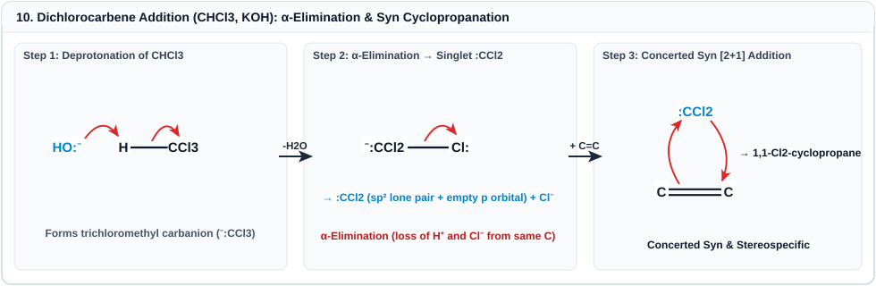

## 試劑
- CHCl3, KOH

## 家族
- syn：concerted（對照通則：syn = concerted，anti = three-membered ring opened by back-side attack）。

## 中間體
- none; :CCl2 forms by deprotonation of CHCl3 giving ⁻CCl3, then loss of Cl⁻

## Regio
- n/a

## Stereo
- syn, stereospecific

## Rearrangement
- no

## 對比
- vs simmons-smith：兩者皆為 syn、stereospecific 形成 cyclopropane 環；`carbene-dichloro` 由 `CHCl3, KOH` 經 deprotonation 得到 `⁻CCl3` 再脫去 `Cl⁻` 產生 `:CCl2`（concerted 加成，無反應中間體），而 `simmons-smith` 使用 `CH2I2, Zn(Cu), ether` 經由 carbenoid 進行反應。

## 例子
<!-- Only the vetted examples listed below. Others must be left TODO. -->
TODO

## 反應機構
- 完整步驟與彎箭頭解析詳見 [mechanisms.md — carbene-dichloro](../../mechanisms.md#10-carbene-dichloro)

