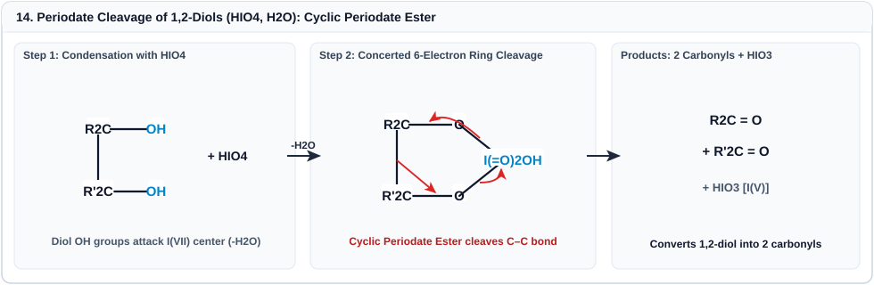

## 試劑
- HIO4, H2O

## 家族
- cleavage：oxidative cleavage of 1,2-diols（對照加成通則：syn = concerted，anti = three-membered ring opened by back-side attack）。

## 中間體
- cyclic periodate ester

## Regio
- n/a

## Stereo
- n/a

## Rearrangement
- n/a

## 對比
- converts a 1,2-diol into 2 carbonyls

## 例子
<!-- Only the vetted examples listed below. Others must be left TODO. -->
TODO

## 反應機構
- 完整步驟與彎箭頭解析詳見 [mechanisms.md — diol-cleavage](../../mechanisms.md#14-diol-cleavage)

