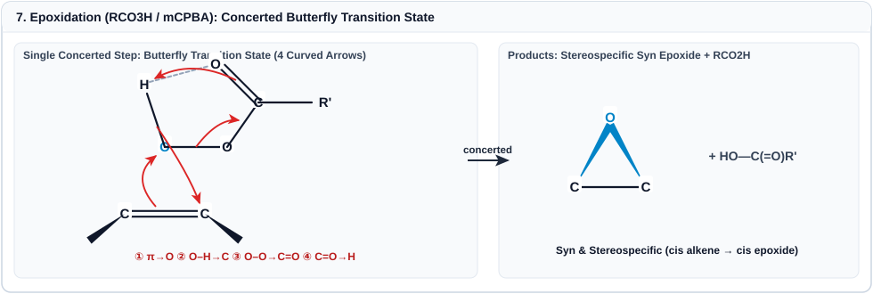

## 試劑
- RCO3H (e.g. mCPBA)

## 家族
- syn：concerted（對照通則：syn = concerted，anti = three-membered ring opened by back-side attack）。

## 中間體
- none (concerted); the epoxide is the PRODUCT

## Regio
- n/a

## Stereo
- syn; stereospecific (cis alkene → cis-substituted epoxide)

## Rearrangement
- no

## 對比
- vs epoxide-hydrolysis：epoxidation 為 concerted syn addition，直接得到 epoxide 為 product；後續加上 `H3O⁺` (epoxide-hydrolysis) 則由水分子從背面開環得到 trans-1,2-diol。

## 例子
<!-- Only the vetted examples listed below. Others must be left TODO. -->
- 1-methylcyclohexene + RCO3H → 1-methyl-1,2-epoxycyclohexane; then H3O⁺ → trans diol

## 反應機構
- 完整步驟與彎箭頭解析詳見 [mechanisms.md — epoxidation](../../mechanisms.md#7-epoxidation)

