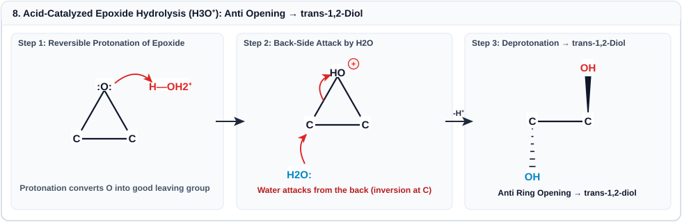
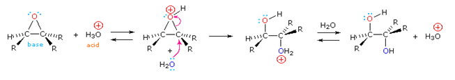

## 試劑
- H3O⁺

## 家族
- anti：three-membered ring opened by back-side attack（對照通則：syn = concerted，anti = three-membered ring opened by back-side attack）。

## 中間體
- protonated epoxide

## Regio
- water attacks from the back

## Stereo
- anti → trans-1,2-diol

## Rearrangement
- no

## 對比
- vs OsO4 (cis diol)：epoxidation 接 `H3O⁺` 開環為 anti 路徑，得到 trans-1,2-diol；`OsO4` 經由 cyclic osmate ester 為 syn 路徑，得到 cis-1,2-diol。

## 例子
<!-- Only the vetted examples listed below. Others must be left TODO. -->
- 1-methylcyclohexene + RCO3H → 1-methyl-1,2-epoxycyclohexane; then H3O⁺ → trans diol

## 反應機構
- 完整步驟與彎箭頭解析詳見 [mechanisms.md — epoxide-hydrolysis](../../mechanisms.md#8-epoxide-hydrolysis)

