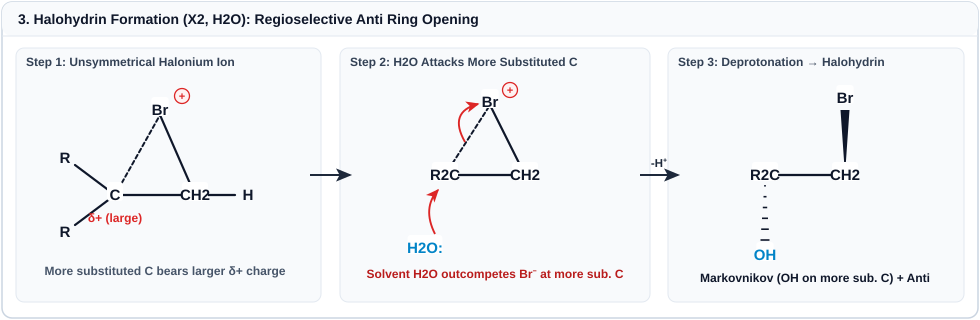

## 試劑
- X2, H2O

## 家族
- anti：three-membered ring opened by back-side attack（對照通則：syn = concerted，anti = three-membered ring opened by back-side attack）。

## 中間體
- halonium ion

## Regio
- Markovnikov: OH on more substituted C

## Stereo
- anti

## Rearrangement
- no

## 對比
- water is the solvent, so it outcompetes X⁻; vs x2-addition

## 例子
<!-- Only the vetted examples listed below. Others must be left TODO. -->
TODO

## 反應機構
- 完整步驟與彎箭頭解析詳見 [mechanisms.md — halohydrin](../../mechanisms.md#3-halohydrin)

