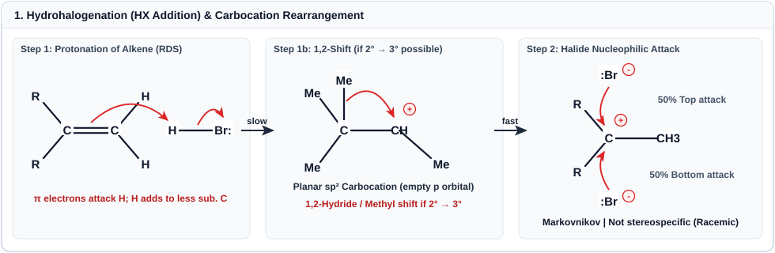

## 試劑
- HCl / HBr / HI, ether

## 家族
- cation：經由 carbocation intermediate 進行親電加成（對照通則：syn = concerted，anti = three-membered ring opened by back-side attack）。

## 中間體
- carbocation

## Regio
- Markovnikov (H on less substituted C)

## Stereo
- not stereospecific

## Rearrangement
- YES, possible（因為經過 carbocation intermediate）

## 對比
- vs oxymercuration：兩者皆為 Markovnikov，但 `hx-addition` 經由 carbocation 會發生 rearrangement；`oxymercuration` 經由 mercurinium ion，NO rearrangement。

## 例子
<!-- Only the vetted examples listed below. Others must be left TODO. -->
- 1-methylcyclohexene + HBr → 1-bromo-1-methylcyclohexane
- 3,3-dimethyl-1-butene + HBr → 2-bromo-2,3-dimethylbutane (rearranged, methyl shift)

## 反應機構
- 完整步驟與彎箭頭解析詳見 [mechanisms.md — hx-addition](../../mechanisms.md#1-hx-addition)

