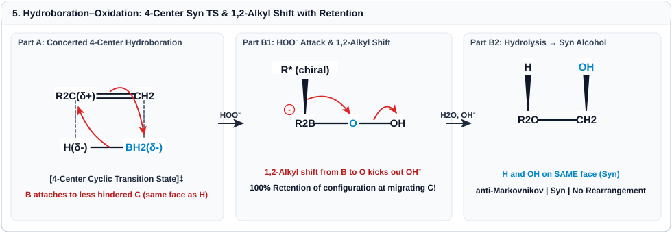
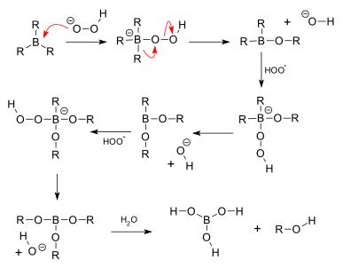
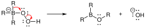

## 試劑
- 1. BH3, THF; 2. H2O2, OH⁻

## 家族
- syn：concerted（對照通則：syn = concerted，anti = three-membered ring opened by back-side attack）。

## 中間體
- none (concerted, 4-center TS)

## Regio
- anti-Markovnikov (OH on less substituted C)

## Stereo
- syn

## Rearrangement
- no

## 對比
- vs oxymercuration：hydroboration 為 anti-Markovnikov 且 syn addition（concerted, 4-center TS）；oxymercuration 為 Markovnikov（經由 mercurinium ion，且 NaBH4 step scrambles stereo）。

## 例子
<!-- Only the vetted examples listed below. Others must be left TODO. -->
- 1-methylcyclohexene + BH3; H2O2/OH⁻ → trans-2-methylcyclohexanol

## 反應機構
- 完整步驟與彎箭頭解析詳見 [mechanisms.md — hydroboration](../../mechanisms.md#5-hydroboration)

