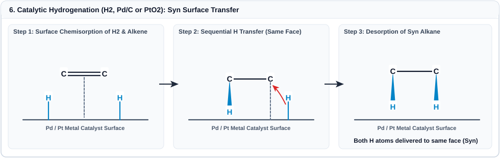
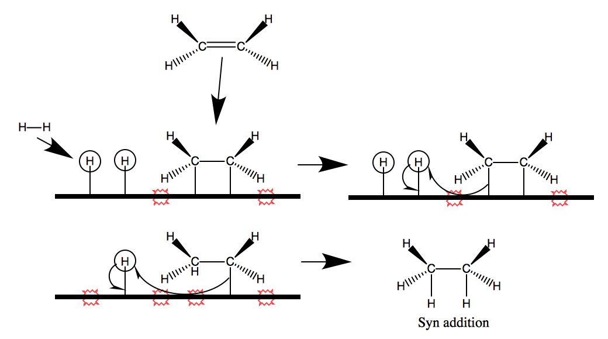

## 試劑
- H2, Pd/C or PtO2

## 家族
- syn：concerted（對照通則：syn = concerted，anti = three-membered ring opened by back-side attack）。

## 中間體
- none (concerted on catalyst surface)

## Regio
- n/a

## Stereo
- syn

## Rearrangement
- no

## 對比
- n/a

## 例子
<!-- Only the vetted examples listed below. Others must be left TODO. -->
TODO

## 反應機構
- 完整步驟與彎箭頭解析詳見 [mechanisms.md — hydrogenation](../../mechanisms.md#6-hydrogenation)

