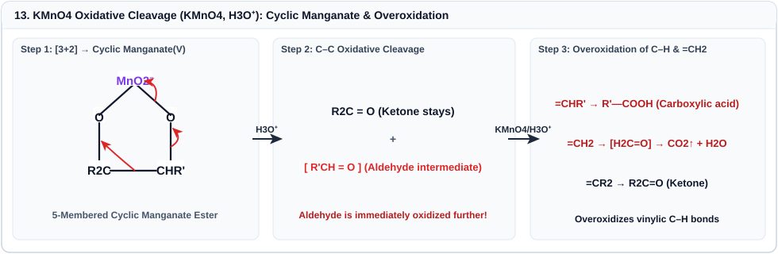

## 試劑
- KMnO4, H3O⁺

## 家族
- cleavage：oxidative cleavage of alkenes（對照加成通則：syn = concerted，anti = three-membered ring opened by back-side attack）。

## 中間體
- n/a

## Regio
- n/a

## Stereo
- n/a

## Rearrangement
- n/a

## 對比
- overoxidizes: C–H becomes COOH, =CH2 becomes CO2; vs ozonolysis（`ozonolysis` 停在 aldehyde/ketone）。

## 例子
<!-- Only the vetted examples listed below. Others must be left TODO. -->
- 1-methylcyclohexene + KMnO4/H3O⁺ → 6-oxoheptanoic acid

## 反應機構
- 完整步驟與彎箭頭解析詳見 [mechanisms.md — kmno4-cleavage](../../mechanisms.md#13-kmno4-cleavage)

