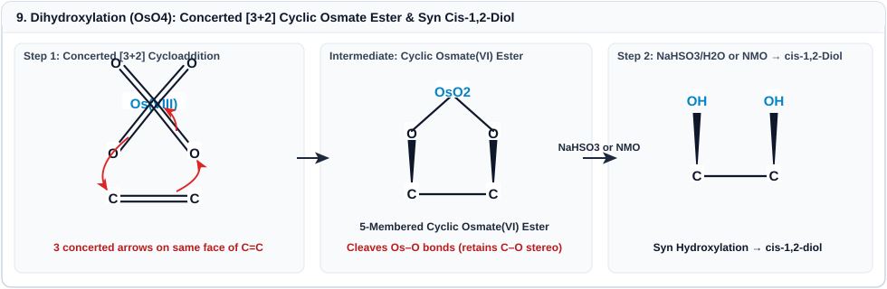

## 試劑
- 1. OsO4; 2. NaHSO3, H2O (or cat. OsO4 + NMO)

## 家族
- syn：concerted（對照通則：syn = concerted，anti = three-membered ring opened by back-side attack）。

## 中間體
- cyclic osmate ester

## Regio
- n/a

## Stereo
- syn → cis-1,2-diol

## Rearrangement
- no

## 對比
- vs epoxide-hydrolysis：`OsO4` 經由 cyclic osmate ester 進行 syn hydroxylation 得到 cis-1,2-diol；`epoxide-hydrolysis` (`RCO3H` then `H3O⁺`) 經由 protonated epoxide 背面開環 (anti) 得到 trans-1,2-diol。

## 例子
<!-- Only the vetted examples listed below. Others must be left TODO. -->
- 1-methylcyclohexene + OsO4 → cis diol

## 反應機構
- 完整步驟與彎箭頭解析詳見 [mechanisms.md — oso4-hydroxylation](../../mechanisms.md#9-oso4-hydroxylation)

