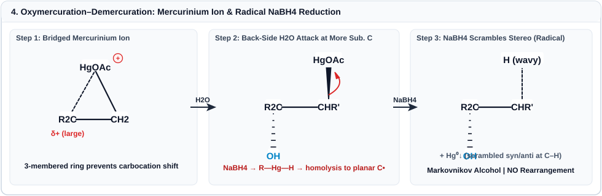
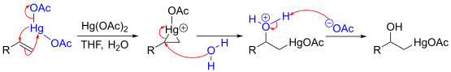

## 試劑
- 1. Hg(OAc)2, H2O/THF; 2. NaBH4

## 家族
- three-membered-ring intermediate, then Nu opens the ring（對照通則：syn = concerted，anti = three-membered ring opened by back-side attack）。

## 中間體
- mercurinium ion

## Regio
- Markovnikov

## Stereo
- cannot be called syn/anti (NaBH4 step scrambles it)

## Rearrangement
- NO

## 對比
- vs hydroboration（Markovnikov vs anti-Markovnikov hydration）
- vs HX（皆為 Markovnikov，但 oxymercuration 經由 mercurinium ion 不發生 rearrangement，HX 經由 carbocation 可能發生 rearrangement）

## 例子
<!-- Only the vetted examples listed below. Others must be left TODO. -->
- 1-methylcyclohexene + Hg(OAc)2/H2O; NaBH4 → 1-methylcyclohexanol
- 3,3-dimethyl-1-butene + Hg(OAc)2/H2O; NaBH4 → 3,3-dimethyl-2-butanol (no rearrangement)

## 反應機構
- 完整步驟與彎箭頭解析詳見 [mechanisms.md — oxymercuration](../../mechanisms.md#4-oxymercuration)

