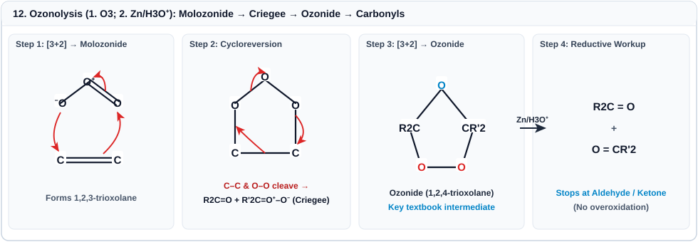

## 試劑
- 1. O3; 2. Zn/H3O⁺

## 家族
- cleavage：oxidative cleavage of alkenes（對照加成通則：syn = concerted，anti = three-membered ring opened by back-side attack）。

## 中間體
- ozonide

## Regio
- n/a

## Stereo
- n/a

## Rearrangement
- n/a

## 對比
- vs kmno4-cleavage: stops at aldehyde/ketone（`ozonolysis` 用 `Zn/H3O⁺` 還原處理會停在 aldehyde/ketone，不會繼續氧化成羧酸或 CO2）。

## 例子
<!-- Only the vetted examples listed below. Others must be left TODO. -->
- 1-methylcyclohexene + O3; Zn → 6-oxoheptanal

## 反應機構
- 完整步驟與彎箭頭解析詳見 [mechanisms.md — ozonolysis](../../mechanisms.md#12-ozonolysis)

