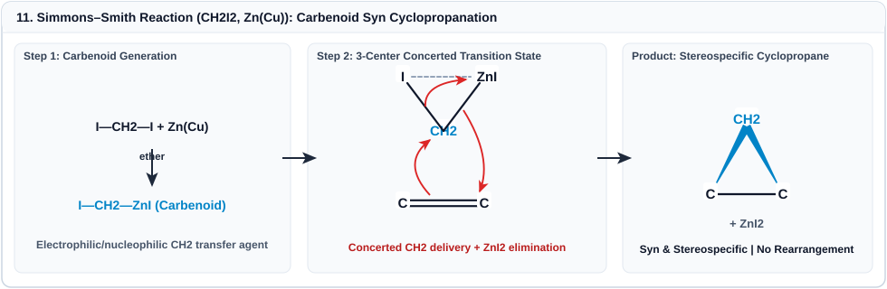
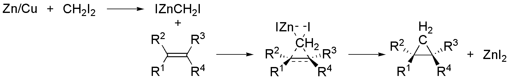

## 試劑
- CH2I2, Zn(Cu), ether

## 家族
- syn：concerted（對照通則：syn = concerted，anti = three-membered ring opened by back-side attack）。

## 中間體
- carbenoid

## Regio
- n/a

## Stereo
- syn, stereospecific

## Rearrangement
- no

## 對比
- vs carbene-dichloro：`simmons-smith` 以 `CH2I2, Zn(Cu), ether` 經由 carbenoid 形成無鹵素取代的 cyclopropane；`carbene-dichloro` 以 `CHCl3, KOH` 產生 `:CCl2` 形成 dichlorocyclopropane，兩者皆為 syn, stereospecific。

## 例子
<!-- Only the vetted examples listed below. Others must be left TODO. -->
TODO

## 反應機構
- 完整步驟與彎箭頭解析詳見 [mechanisms.md — simmons-smith](../../mechanisms.md#11-simmons-smith)

