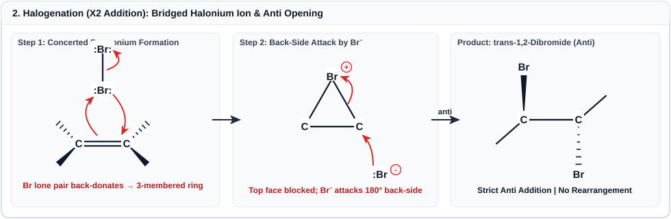
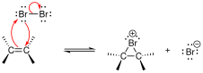

## 試劑
- Cl2 or Br2, CH2Cl2

## 家族
- anti：three-membered ring opened by back-side attack（對照通則：syn = concerted，anti = three-membered ring opened by back-side attack）。

## 中間體
- halonium ion

## Regio
- n/a (both X identical)

## Stereo
- anti

## Rearrangement
- no

## 對比
- vs halohydrin (solvent changes the Nu)：在 inert solvent (`CH2Cl2`) 中由 X⁻ 開環得到 dihalide；若以 `H2O` 為 solvent 則由水分子優先開環生成 halohydrin。

## 例子
<!-- Only the vetted examples listed below. Others must be left TODO. -->
- 1-methylcyclohexene + Br2 → trans-1,2-dibromo-1-methylcyclohexane

## 反應機構
- 完整步驟與彎箭頭解析詳見 [mechanisms.md — x2-addition](../../mechanisms.md#2-x2-addition)

