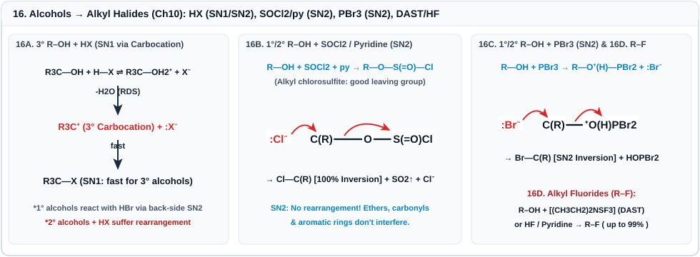

## 試劑
- **HX**（$\text{HCl}$ / $\text{HBr}$ / $\text{HI}$，通常於 ether 或水溶液）
- **$\text{SOCl}_2$, pyridine**（thionyl chloride，將醇轉為 $\text{R–Cl}$）
- **$\text{PBr}_3$, ether**（phosphorus tribromide，將醇轉為 $\text{R–Br}$）
- **$\text{[(CH}_3\text{CH}_2)_2\text{NSF}_3\text{]}$ (diethylaminosulfur trifluoride) 或 $\text{HF}$, pyridine**（將醇轉為 alkyl fluoride $\text{R–F}$）

## 家族
- **親核取代反應（Nucleophilic Substitution, $\text{R–OH} \to \text{R–X}$）** `[needs-review]`
  - 核心問題：$-\text{OH}$ 是強鹼、極差的離去基（poor leaving group），鹵素離子 $\text{X}^-$ 無法直接取代。
  - 解決方式：三種試劑皆先將 $-\text{OH}$ 轉化為**好離去基**（$-\text{OH}_2^+$、$-\text{OSOCl}$、$-\text{OPBr}_2$），再由 $\text{X}^-$ 進行取代。

## 1°、2°、3° 級醇生成 Alkyl Halides 的選擇策略
<!-- [needs-review] McMurry Ch.10 Section 10.6 -->

| 醇的級數 | 最佳試劑 | 反應機構 | 為什麼這樣選？（優缺點與限制） |
|---|---|---|---|
| **3° 醇 ($\text{R}_3\text{COH}$)** | **$\text{HX}$** ($\text{HCl}, \text{HBr}, \text{HI}$)，$0\,^\circ\text{C}$～室溫 | **$\text{S}_\text{N}1$** | 質子化生成 $-\text{OH}_2^+$ 後迅速離去形成穩定的 **3° carbocation**，幾分鐘內即可高產率反應。 ⚠️ **不可用 $\text{SOCl}_2$ / $\text{PBr}_3$**：因為 3° 碳立體阻礙過大，無法進行背面攻擊的 $\text{S}_\text{N}2$。 |
| **2° 醇 ($\text{R}_2\text{CHOH}$)** | **$\text{SOCl}_2$ / pyridine**（製 $\text{R–Cl}$） **$\text{PBr}_3$ / ether**（製 $\text{R–Br}$） | **$\text{S}_\text{N}2$** | 條件溫和、不經 carbocation，因此**不會發生 rearrangement**，且立體中心會完全 **inversion**。 ⚠️ **避免用 $\text{HX}$**：2° 醇對 $\text{HX}$ 反應較慢（需加熱），且走 $\text{S}_\text{N}1$ 會產生 carbocation rearrangement、消旋化与酸催化消去副產物。 |
| **1° 醇 ($\text{RCH}_2\text{OH}$)** | **$\text{SOCl}_2$ / pyridine**（製 $\text{R–Cl}$） **$\text{PBr}_3$ / ether**（製 $\text{R–Br}$） *(或 $\text{HBr}$ 加熱)* | **$\text{S}_\text{N}2$** | 1° 碳立體阻礙最小，走 $\text{S}_\text{N}2$ 最快、產率最高且條件溫和。 若用 $\text{HX}$：$\text{HBr}$ 雖可對無支鏈 1° 醇走 $\text{S}_\text{N}2$，但需高溫強酸（易破壞敏感官能基），且 $\text{HCl}$ 對 1° 醇反應極慢。 |

## 中間體
- **$\text{HX}$ 路徑**：oxonium ion ($\text{R–OH}_2^+$)；若為 3°（及多數 2°）醇，進一步生成 **carbocation ($\text{R}^+$)**。 `[needs-review]`
- **$\text{SOCl}_2$ 路徑**：alkyl chlorosulfite ($\text{R–O–S(=O)Cl}$)，隨後脫去 $\text{SO}_2\uparrow$ 與 $\text{Cl}^-$。 `[needs-review]`
- **$\text{PBr}_3$ 路徑**：dibromophosphite ($\text{R–O–PBr}_2$)，1 當量 $\text{PBr}_3$ 可與 3 當量 $\text{R–OH}$ 反應生成 $3\,\text{R–Br} + \text{H}_3\text{PO}_3$。 `[needs-review]`

## Regio
- 取代發生在原本接 $-\text{OH}$ 的碳上（但若使用 $\text{HX}$ 走 $\text{S}_\text{N}1$ 發生 carbocation rearrangement，鹵素會接在重排後更穩定的碳上）。 `[needs-review]`

## Stereo
- **$\text{HX}$ (3° / 2° 醇，$\text{S}_\text{N}1$)**：not stereospecific（經平面 carbocation，產生 racemization）。 `[needs-review]`
- **$\text{SOCl}_2$ / pyridine 與 $\text{PBr}_3$ (1° / 2° 醇，$\text{S}_\text{N}2$)**：**inversion of configuration**（背面攻擊，$R \leftrightarrow S$ 翻轉）。 `[needs-review]`

## Rearrangement
- **$\text{HX}$**：**YES, possible**（當經過 $\text{S}_\text{N}1$ carbocation intermediate，或 $\beta$-支鏈醇受熱時可能發生 hydride / methyl shift）。 `[needs-review]`
- **$\text{SOCl}_2$ / $\text{PBr}_3$**：**NO**（走 $\text{S}_\text{N}2$ 協同背面取代，不形成自由 carbocation）。 `[needs-review]`

## 對比
- **$\text{HX}$ vs $\text{SOCl}_2$ / $\text{PBr}_3$**：
  - **3° 醇**只能用 **$\text{HX}$**（$\text{S}_\text{N}1$，常溫即反應）。
  - **1°、2° 醇**優先選 **$\text{SOCl}_2$ 或 $\text{PBr}_3$**（$\text{S}_\text{N}2$，溫和、無重排、構型翻轉 inversion）。 `[needs-review]`
  - **官能基耐受性（Functional group tolerance）**：$\text{SOCl}_2$ 與 $\text{PBr}_3$ 產率高，且分子中若同時存在 **ethers、carbonyls、aromatic rings 通常不會干擾（don't usually interfere）**。
  - **製備 Alkyl Fluorides ($\text{R–F}$)**：若要由醇製備氟烷，使用 **diethylaminosulfur trifluoride $\text{[(CH}_3\text{CH}_2)_2\text{NSF}_3\text{]}$** 或 **$\text{HF}$ in pyridine solvent**。

## 例子
- $3\,\text{CH}_3\text{CH}_2\text{CH(OH)CH}_3$ (2-Butanol) + $\text{PBr}_3$ ($\text{Ether}, 35\,^\circ\text{C}$) → $3\,\text{CH}_3\text{CH}_2\text{CH(Br)CH}_3$ (2-Bromobutane, 86%) + $\text{H}_3\text{PO}_3$
- Cyclohexanol + $\text{HF}$, Pyridine → Fluorocyclohexane (99%)
- 2-methyl-2-propanol (3° alcohol) + $\text{HCl}$ ($0\,^\circ\text{C}$) → 2-chloro-2-methylpropane ($\text{S}_\text{N}1$) `[needs-review]`
- (R)-2-butanol (2° alcohol) + $\text{SOCl}_2$, pyridine → (S)-2-chlorobutane ($\text{S}_\text{N}2$, inversion) `[needs-review]`

## 反應機構
- 完整步驟與彎箭頭解析詳見 [mechanisms.md — alcohol-to-alkyl-halide](../../mechanisms.md#16-alcohol-to-alkyl-halide)

