# Organic Chemistry：完整反應機構詳解（Mechanisms Master Reference）

> **圖例與符號說明（McMurry 課本標準表示法）**
> - **雙電子彎箭頭（`↷`，Curved Arrow / Two-Electron Push）**：代表一對電子（$2e^-$，來自孤對電子 lone pair、`π` 鍵或 `σ` 鍵）從**起點（富電子端 Nucleophile）**流向**終點（缺電子端 Electrophile）**。
> - **自由基單鉤箭頭（`⇀`，Fishhook Arrow / One-Electron Push）**：代表單一電子（$1e^-$）的均裂（homolysis）或自由基偶合轉移。
> - **過渡態符號（`‡`）**：代表協同反應（concerted reaction）或速率決定步驟的 Transition State。
> - **標記 `[needs-review]`**：超出 Ch08 初始簡表、依據 McMurry 課本完整機構展開的細節。

---

## 目錄（Table of Contents）

### Chapter 8：Alkenes — Reactions and Synthesis
1. [Hydrohalogenation (`hx-addition`)：HX 親電加成與 Carbocation 重排](#1-hx-addition)
2. [Halogenation (`x2-addition`)：$\text{X}_2$ 經 Halonium Ion 的 Anti 加成](#2-x2-addition)
3. [Halohydrin Formation (`halohydrin`)：$\text{X}_2 / \text{H}_2\text{O}$ 區域與立體選擇性開環](#3-halohydrin)
4. [Oxymercuration–Demercuration (`oxymercuration`)：羥汞化—脫汞反應](#4-oxymercuration)
5. [Hydroboration–Oxidation (`hydroboration`)：硼氫化—氧化反應（含 4 中心過渡態與硼遷移完整機構）](#5-hydroboration)
6. [Catalytic Hydrogenation (`hydrogenation`)：催化氫化表面反應機構](#6-hydrogenation)
7. [Epoxidation (`epoxidation`)：過氧酸（mCPBA）蝴蝶型協同環氧化機構](#7-epoxidation)
8. [Acid-Catalyzed Epoxide Hydrolysis (`epoxide-hydrolysis`)：酸催化環氧乙烷背面開環](#8-epoxide-hydrolysis)
9. [Dihydroxylation (`oso4-hydroxylation`)：$\text{OsO}_4$ 順式雙羥基化與還原／催化循環](#9-oso4-hydroxylation)
10. [Dichlorocarbene Addition (`carbene-dichloro`)：$\alpha$-消去生成 $:!\text{CCl}_2$ 與協同環丙烷化](#10-carbene-dichloro)
11. [Simmons–Smith Reaction (`simmons-smith`)：類卡賓（Carbenoid）協同環丙烷化](#11-simmons-smith)
12. [Ozonolysis (`ozonolysis`)：臭氧化（Molozonide $\to$ Criegee 重排 $\to$ Ozonide $\to$ 還原裂解）](#12-ozonolysis)
13. [$\text{KMnO}_4$ Oxidative Cleavage (`kmno4-cleavage`)：酸性高錳酸鉀氧化裂解與過度氧化](#13-kmno4-cleavage)
14. [Periodate Cleavage of 1,2-Diols (`diol-cleavage`)：$\text{HIO}_4$ 環狀高碘酸酯裂解機構](#14-diol-cleavage)

### Chapter 10：Organohalides
15. [Allylic Bromination with NBS (`allylic-bromination`)：NBS 自由基鏈鎖反應與 $\text{Br}_2$ 低濃度循環](#15-allylic-bromination)
16. [Preparation of Alkyl Halides from Alcohols (`alcohol-to-alkyl-halide`)：$\text{HX}$、$\text{SOCl}_2$、$\text{PBr}_3$ 與 $\text{DAST}/\text{HF}$ 完整機構](#16-alcohol-to-alkyl-halide)

---

# Chapter 8：Alkenes — Reactions and Synthesis

## 1. Hydrohalogenation (`hx-addition`)：HX 親電加成與 Carbocation 重排
- **對應反應卡**：[hx-addition.md](ch08/cards/hx-addition.md)
- **總反應式**：
  $$\text{R}_2\text{C=CHR'} + \text{H–X} \xrightarrow{\text{ether}} \text{R}_2\text{C(X)–CH}_2\text{R'} \quad (\text{X} = \text{Cl, Br, I})$$
- **反應特徵**：兩步親電加成（Two-step electrophilic addition）｜**Markovnikov**｜**Not stereospecific**｜**Rearrangement: YES**

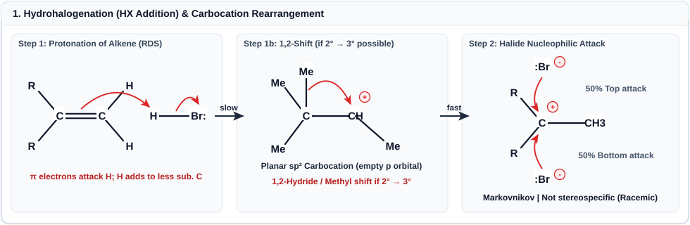

### Step 1：$\pi$ 鍵親核質子化，生成較穩定的 Carbocation（速率決定步驟 RDS）
1. **LaTeX 步驟式**：
   $$\text{R}_2\text{C=CH}_2 + \text{H–Br} \xrightarrow{\text{slow (RDS)}} \text{R}_2\overset{+}{\text{C}}\text{–CH}_3 + :\!\ddot{\text{Br}}\!:^-$$
2. **彎箭頭電子流向（Curved Arrows）**：
   - **箭頭 ①（`C=C π 鍵 ↷ H`）**：烯烴富電子的 $\pi$ 鍵電子對作為 Nucleophile，攻擊強酸 $\text{H–X}$ 中帶部分正電的 $\text{H}^{\delta+}$，並將 $\text{H}$ 接在**取代數較少的碳**（less substituted C）上，使正電荷落在**取代數較多的碳**（more substituted C，因為超共軛 hyperconjugation 與誘導效應使 $3^\circ > 2^\circ > 1^\circ$ carbocation 更穩定）。
   - **箭頭 ②（`H–X σ 鍵 ↷ X`）**：$\text{H–X}$ 的 $\sigma$ 鍵電子對完全轉移給鹵素原子，形成鹵素陰離子 $:\!\ddot{\text{X}}\!:^-$。

### Step 1b（若結構允許）：Carbocation Rearrangement（1,2-Hydride 或 1,2-Methyl Shift）
- **觸發條件**：當 Step 1 產生的 $2^\circ$ carbocation 鄰接碳（$\alpha$-C）為 $3^\circ$ 或 $4^\circ$ 碳時，會發生極快速的分子內遷移，轉變為更穩定的 $3^\circ$ carbocation（例如課本實例：`3,3-dimethyl-1-butene + HBr`）。
1. **LaTeX 步驟式**：
   $$\text{(CH}_3)_3\text{C–}\overset{+}{\text{C}}\text{H–CH}_3 \;(2^\circ) \xrightarrow{\text{1,2-methyl shift}} (\text{CH}_3)_2\overset{+}{\text{C}}\text{–CH(CH}_3)_2 \;(3^\circ)$$
2. **彎箭頭電子流向（Curved Arrows）**：
   - **箭頭 ①（`C–CH3 (或 C–H) σ 鍵 ↷ C⁺ 空 p 軌域`）**：鄰接碳上的 $-\text{CH}_3$（或 $-\text{H}$）帶著整對 $\sigma$ 鍵電子直接滑移至正電碳的空 $p$ 軌域，正電荷轉移至原本的四級／三級碳上。

### Step 2：鹵素陰離子 $:\!\ddot{\text{X}}\!:^-$ 親核捕獲 Carbocation
1. **LaTeX 步驟式**：
   $$\text{R}_2\overset{+}{\text{C}}\text{–CH}_3 + :\!\ddot{\text{Br}}\!:^- \xrightarrow{\text{fast}} \text{R}_2\text{C(Br)–CH}_3$$
2. **彎箭頭電子流向（Curved Arrows）**：
   - **箭頭 ①（`X⁻ 孤對電子 ↷ C⁺`）**：$:\!\ddot{\text{X}}\!:^-$ 的孤對電子從平面 $sp^2$ carbocation 空 $p$ 軌域的**上方或下方（機率各 50%）**進攻，形成新的 $\text{C–X}$ $\sigma$ 鍵。因此若生成新的對掌中心，必然得到外消旋混合物（not stereospecific）。

---

## 2. Halogenation (`x2-addition`)：$\text{X}_2$ 經 Halonium Ion 的 Anti 加成
- **對應反應卡**：[x2-addition.md](ch08/cards/x2-addition.md)
- **總反應式**：
  $$\text{R}_2\text{C=CR}_2 + \text{X}_2 \xrightarrow{\text{CH}_2\text{Cl}_2} \text{trans-1,2-dihalide} \quad (\text{X} = \text{Cl, Br})$$
- **反應特徵**：三員環架橋中間體（Bridged halonium ion）｜**Stereo: Anti**｜**Rearrangement: NO**

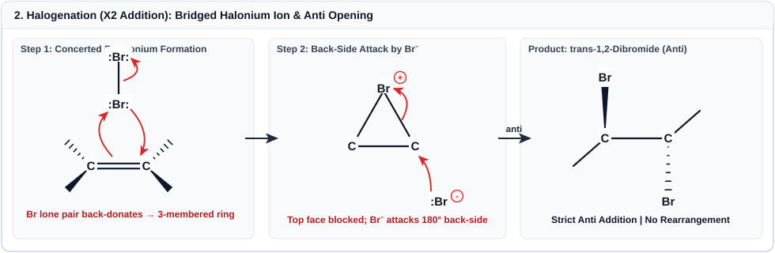

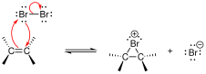

### Step 1：烯烴攻擊 $\text{X}_2$ 並同時由鹵素孤對電子回捐，形成三員環 Halonium Ion
1. **LaTeX 步驟式**：
   $$\text{C=C} + \text{Br–Br} \longrightarrow \text{Bridged Bromonium Ion } (\text{C}_2\text{Br}^+) + :\!\ddot{\text{Br}}\!:^-$$
2. **彎箭頭電子流向（Curved Arrows）**： `[needs-review]`
   - **箭頭 ①（`C=C π 鍵 ↷ 近端 Br`）**：當 $\text{Br}_2$ 接近富電子的烯烴 $\pi$ 電子雲時被極化（近端為 $\text{Br}^{\delta+}$，遠端為 $\text{Br}^{\delta-}$）；$\pi$ 鍵電子對攻擊近端 $\text{Br}^{\delta+}$。
   - **箭頭 ②（`近端 Br 孤對電子 ↷ 另一個雙鍵 C`）**：近端 $\text{Br}$ 上的孤對電子同時回捐給另一個雙鍵碳，形成架橋三員環 **bromonium ion**（避免產生不穩定的自由 carbocation，因此**絕不發生重排**）。
   - **箭頭 ③（`Br–Br σ 鍵 ↷ 遠端 Br`）**：$\text{Br–Br}$ 鍵斷裂，釋出 $:\!\ddot{\text{Br}}\!:^-$。

### Step 2：$:\!\ddot{\text{X}}\!:^-$ 由背面進行 $\text{S}_\text{N}2$-like 開環（Back-side Attack $\to$ Anti Addition）
1. **LaTeX 步驟式**：
   $$\text{Bridged Bromonium Ion} + :\!\ddot{\text{Br}}\!:^- \xrightarrow{\text{back-side attack}} \text{trans-1,2-dibromide}$$
2. **彎箭頭電子流向（Curved Arrows）**：
   - **箭頭 ①（`Br⁻ 孤對電子 ↷ 三員環碳背面`）**：由於三員環同側（top face）被龐大的 $\text{Br}^+$ 架橋遮擋，$:\!\ddot{\text{Br}}\!:^-$ 只能從**反側（bottom face，背面 180°）**進攻其中一個碳（對掌碳發生構型翻轉 inversion）。
   - **箭頭 ②（`C–Br⁺ σ 鍵 ↷ 架橋 Br⁺`）**：被攻擊碳與 $\text{Br}^+$ 之間的 $\sigma$ 鍵斷裂，電子對歸還給架橋溴原子，使兩個溴原子必定處於雙鍵原平面的相反兩側（**anti addition**；環烯烴必得 *trans*-1,2-dibromide）。

---

## 3. Halohydrin Formation (`halohydrin`)：$\text{X}_2 / \text{H}_2\text{O}$ 區域與立體選擇性開環
- **對應反應卡**：[halohydrin.md](ch08/cards/halohydrin.md)
- **總反應式**：
  $$\text{R}_2\text{C=CHR'} + \text{X}_2 + \text{H}_2\text{O} \longrightarrow \text{R}_2\text{C(OH)–CH(X)R'} + \text{HX}$$
- **反應特徵**：Bridged halonium ion｜**Regio: Markovnikov（$-\text{OH}$ 在取代較多的 C）**｜**Stereo: Anti**｜**Rearrangement: NO**

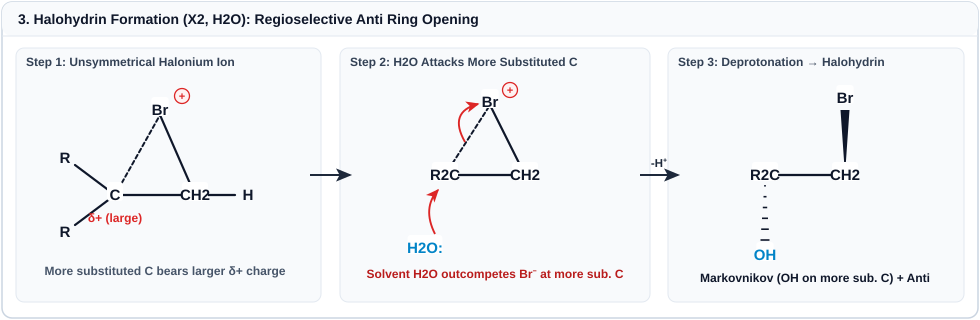

### Step 1：形成不對稱的三員環 Halonium Ion
1. **LaTeX 步驟式**：
   $$\text{R}_2\text{C=CH}_2 + \text{Br–Br} \longrightarrow [\text{R}_2\text{C–CH}_2\text{Br}^+] + \text{Br}^-$$
2. **彎箭頭電子流向（Curved Arrows）**：
   - 與 `x2-addition` Step 1 相同（`C=C π 鍵 ↷ Br`、`Br 孤對電子 ↷ C`、`Br–Br σ 鍵 ↷ Br⁻`）。
   - **關鍵不對稱性**：在三員環 halonium ion 中，取代基較多的碳（$3^\circ$ 或 $2^\circ$ C）更能承受正電荷，因此該碳上的 **$\delta+$ 顯著較大**，且其 $\text{C–Br}^+$ 鍵較長、較弱（具有較多 carbocation character，但仍被橋鍵鎖住故不重排）。

### Step 2：溶劑水分子（$\text{H}_2\text{O}$）由背面選擇性攻擊取代較多的碳
1. **LaTeX 步驟式**：
   $$[\text{R}_2\text{C(}^{\delta+}\text{)–CH}_2\text{Br}^+] + \text{H}_2\ddot{\text{O}}: \xrightarrow{\text{back-side at more sub. C}} \text{R}_2\text{C(}\overset{+}{\text{O}}\text{H}_2\text{)–CH}_2\text{Br}$$
2. **彎箭頭電子流向（Curved Arrows）**：
   - **箭頭 ①（`H2O 孤對電子 ↷ 多取代碳背面`）**：因為 $\text{H}_2\text{O}$ 是溶劑，濃度遠高於剛生成的 $\text{Br}^-$，水分子在競爭中勝出；且開環過渡態具 $\text{S}_\text{N}1$-like 電荷特徵，水分子專一攻擊 **$\delta+$ 較大的多取代碳背面**。
   - **箭頭 ②（`多取代 C–Br⁺ σ 鍵 ↷ Br⁺`）**：三員環打開，$\text{Br}$ 留在取代較少的碳上（與 $-\text{OH}_2^+$ 呈 **anti** 關係）。

### Step 3：去質子化（Deprotonation）生成中性 Halohydrin
1. **LaTeX 步驟式**：
   $$\text{R}_2\text{C(}\overset{+}{\text{O}}\text{H}_2\text{)–CH}_2\text{Br} + \text{H}_2\ddot{\text{O}}: \longrightarrow \text{R}_2\text{C(OH)–CH}_2\text{Br} + \text{H}_3\text{O}^+$$
2. **彎箭頭電子流向（Curved Arrows）**：
   - **箭頭 ①（`H2O 孤對電子 ↷ H–O⁺`）** 與 **箭頭 ②（`O–H σ 鍵 ↷ O⁺`）**：另一分子溶劑 $\text{H}_2\text{O}$ 抓取 $-\text{OH}_2^+$ 上的質子，得到 **anti** 且 **Markovnikov**（$-\text{OH}$ 在多取代 C、$-\text{X}$ 在少取代 C）的 halohydrin。

---

## 4. Oxymercuration–Demercuration (`oxymercuration`)：羥汞化—脫汞反應
- **對應反應卡**：[oxymercuration.md](ch08/cards/oxymercuration.md)
- **總反應式**：
  $$\text{R}_2\text{C=CHR'} \xrightarrow[2.\text{ NaBH}_4,\text{ OH}^-]{1.\text{ Hg(OAc)}_2,\text{ H}_2\text{O/THF}} \text{R}_2\text{C(OH)–CH}_2\text{R'} + \text{Hg}^0$$
- **反應特徵**：三員環 Mercurinium ion｜**Regio: Markovnikov**｜**Stereo: Scrambled（不可稱 syn/anti）**｜**Rearrangement: NO**

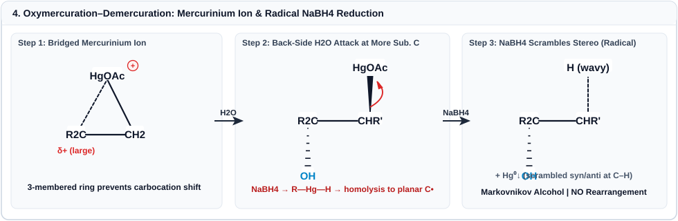

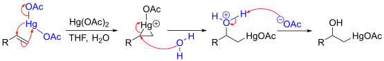

### Step 1：$\text{Hg(OAc)}_2$ 解離並與烯烴形成三員環 Mercurinium Ion
1. **LaTeX 步驟式**：
   $$\text{Hg(OAc)}_2 \rightleftharpoons \text{AcO–Hg}^+ + \text{AcO}^-$$
   $$\text{R}_2\text{C=CH}_2 + \text{AcO–Hg}^+ \longrightarrow \text{Bridged Mercurinium Ion}$$
2. **彎箭頭電子流向（Curved Arrows）**：
   - **箭頭 ①（`C=C π 鍵 ↷ Hg⁺`）**：烯烴 $\pi$ 鍵攻擊親電性的 $\text{AcO–Hg}^+$（或直接攻擊 $\text{Hg(OAc)}_2$ 同時趕走一個 $\text{AcO}^-$）。
   - **箭頭 ②（`Hg d 軌域電子對 ↷ 另一個 C`）**：汞原子回捐電子形成三員環 **mercurinium ion**。多取代碳承受較多正電荷（$\delta+$ 較大），但因三員環鎖住碳骨架，**絕不發生 carbocation rearrangement**。

### Step 2：水分子由背面攻擊 $\delta+$ 較大的多取代碳，隨後去質子化
1. **LaTeX 步驟式**：
   $$\text{Mercurinium Ion} + \text{H}_2\ddot{\text{O}}: \longrightarrow \text{R}_2\text{C(}\overset{+}{\text{O}}\text{H}_2\text{)–CH}_2\text{HgOAc} \xrightarrow{-\text{H}^+\text{ (by AcO}^-\text{ or H}_2\text{O)}} \text{R}_2\text{C(OH)–CH}_2\text{HgOAc}$$
2. **彎箭頭電子流向（Curved Arrows）**：
   - **箭頭 ①（`H2O 孤對電子 ↷ 多取代 C 背面`）**：水分子攻擊 $\delta+$ 最大的多取代碳背面。
   - **箭頭 ②（`多取代 C–Hg⁺ σ 鍵 ↷ Hg⁺`）**：三員環打開，$-\text{HgOAc}$ 留在少取代碳上。
   - **箭頭 ③（`AcO⁻ 或 H2O 孤對電子 ↷ H–O⁺` & `O–H 鍵 ↷ O⁺`）**：$\text{AcO}^-$（或水）抓取質子，形成羥基汞中間體（organomercury alcohol intermediate）與 $\text{HOAc}$。

### Step 3：$\text{NaBH}_4$ 還原脫汞（Demercuration，自由基機構導致立體化學洗牌） `[needs-review]`
1. **LaTeX 步驟式**：
   $$\text{R}_2\text{C(OH)–CH(R')–HgOAc} \xrightarrow{\text{NaBH}_4,\text{ OH}^-} \text{R}_2\text{C(OH)–CH(R')–H} + \text{Hg}^0\downarrow + \text{AcO}^-$$
2. **彎箭頭／單鉤箭頭電子流向**： `[needs-review]`
   - **步驟 3a（Hydride 交換）**：$\text{BH}_4^-$ 提供 $\text{H}^-$ 取代 $\text{Hg}$ 上的 $\text{AcO}^-$，生成不穩定的烷基氫化汞 $\text{R–Hg–H}$。
   - **步驟 3b（均裂 Homolysis，`C–Hg σ 鍵 ⇀ C•` 與 `⇀ •HgH`）**：$\text{C–Hg}$ 鍵發生自由基均裂，生成**平面（或快速翻轉）的碳自由基 $\text{R}_2\text{C(OH)–}\dot{\text{C}}\text{HR'}$**。
   - **步驟 3c（自由基捕獲）**：該碳自由基可從任意一側抓取 $\text{H}\cdot$，因此第一步羥汞化的 anti 立體化學在此步被完全洗掉（**stereochemistry is scrambled**），最終產物無法稱為 syn 或 anti！

---

## 5. Hydroboration–Oxidation (`hydroboration`)：硼氫化—氧化反應
- **對應反應卡**：[hydroboration.md](ch08/cards/hydroboration.md)
- **總反應式**：
  $$\text{R}_2\text{C=CHR'} \xrightarrow[2.\text{ H}_2\text{O}_2,\text{ OH}^-]{1.\text{ BH}_3,\text{ THF}} \text{R}_2\text{CH–CH(OH)R'} \quad (\text{anti-Markovnikov, syn})$$
- **反應特徵**：4-Center concerted TS｜**Regio: anti-Markovnikov**｜**Stereo: Syn**｜**Rearrangement: NO**

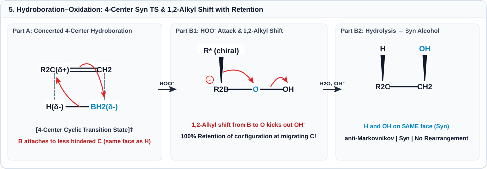

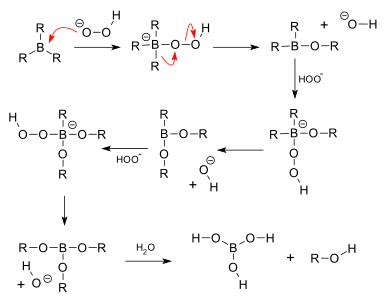

### Part A：Hydroboration（第一步：$\text{BH}_3\cdot\text{THF}$ 協同四中心 Syn 加成）
1. **LaTeX 步驟式**：
   $$3\,\text{R}_2\text{C=CH}_2 + \text{BH}_3 \xrightarrow{\text{THF}} (\text{R}_2\text{CH–CH}_2)_3\text{B} \quad (\text{trialkylborane})$$
2. **彎箭頭電子流向（2 個同步彎箭頭，無中間體）**：
   - **箭頭 ①（`C=C π 鍵 ↷ B 空 p 軌域`）**：烯烴 $\pi$ 鍵電子對攻擊缺電子（Lewis acid，具空 $p$ 軌域）的硼原子 $\text{B}$。因為 $-\text{BH}_2$（以及後續第二次、第三次加成的 $-\text{BHR}$、$-\text{BR}_2$）立體體積較大，為了避開多取代碳的立體阻礙（steric hindrance），**$\text{B}$ 優先接在取代數較少的碳（less substituted C）**上；同時多取代碳在過渡態帶微弱 $\delta+$（electronic effect），剛好穩定過渡態。
   - **箭頭 ②（`B–H σ 鍵 ↷ 多取代 C`）**：在同一瞬間（concerted），$\text{B–H}$ 鍵連同電子對從**同一側（same face）**轉移至帶 $\delta+$ 的多取代碳上。
   - **結果**：$\text{H}$ 與 $\text{B}$ 必為 **syn** 加成，且不經過 carbocation 故**無重排**；連續加成三次得到三烷基硼 $\text{R}_3\text{B}$。

### Part B：Oxidation（第二步：$\text{H}_2\text{O}_2 / \text{OH}^-$ 氧化與 1,2-Alkyl Shift 完整機構） `[needs-review]`

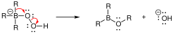

1. **Step B1：過氧化氫去質子化產生親核性極強的 Hydroperoxide Ion ($\text{HOO}^-$)**
   $$\text{HO–OH} + :\!\ddot{\text{O}}\text{H}^- \rightleftharpoons \text{HO–}\ddot{\text{O}}\!:^- + \text{H}_2\text{O}$$
   - **彎箭頭**：`OH⁻ 孤對電子 ↷ H–OOH`，`H–O 鍵 ↷ O⁻`。
2. **Step B2：$\text{HOO}^-$ 親核進攻 $\text{R}_3\text{B}$ 的空 $p$ 軌域，形成四面體硼酸鹽負離子（Borate Complex）**
   $$\text{R}_3\text{B} + :\!\ddot{\text{O}}\text{–OH}^- \longrightarrow \text{R}_3\overset{-}{\text{B}}\text{–O–OH}$$
   - **彎箭頭**：`HOO⁻ 孤對電子 ↷ B 空 p 軌域`。
3. **Step B3：協同 1,2-Alkyl Migration（烷基帶著電子對從 B 遷移至 O，同時踢走 $\text{OH}^-$）**
   - **彎箭頭 ①（`B–R σ 鍵 ↷ 鄰接的 O`）**：硼上的一個烷基 $\text{R}$ **帶著原本的 $\text{C–B}$ $\sigma$ 電子對**直接滑移到鄰接的氧原子上（1,2-alkyl shift）。因為是帶著電子對直接平移，**碳中心的立體構型 100% 保持（Retention of configuration）**！
   - **彎箭頭 ②（`O–OH σ 鍵 ↷ OH`）**：脆弱的過氧鍵 $\text{O–O}$ 同步斷裂，釋出 $:\!\ddot{\text{O}}\text{H}^-$。
   - 此「$\text{HOO}^-$ 加成 $\to$ 1,2-烷基遷移」重複三次，將三個 $\text{C–B}$ 鍵全部轉化為 $\text{C–O}$ 鍵，得到三烷氧基硼酸酯 **trialkyl borate $\text{B(OR)}_3$**。
4. **Step B4：鹼性水解 $\text{B(OR)}_3$ 釋出醇產物**
   $$\text{B(OR)}_3 + \text{OH}^- + 3\,\text{H}_2\text{O} \longrightarrow 3\,\text{R–OH} + \text{B(OH)}_4^-$$
   - **彎箭頭**：`OH⁻ 孤對電子 ↷ B(OR)3` 形成四面體中間體，再踢出 $\text{RO}^-$，最後 $\text{RO}^-$ 向水抓質子（`RO⁻ ↷ H–OH`）生成最終產物 $\text{R–OH}$（整體等效於在雙鍵進行 **syn** 且 **anti-Markovnikov** 的 $\text{H}$ 與 $\text{OH}$ 加成）。

---

## 6. Catalytic Hydrogenation (`hydrogenation`)：催化氫化表面反應機構
- **對應反應卡**：[hydrogenation.md](ch08/cards/hydrogenation.md)
- **總反應式**：
  $$\text{R}_2\text{C=CR}_2 + \text{H}_2 \xrightarrow{\text{Pd/C or PtO}_2} \text{R}_2\text{CH–CHR}_2 \quad (\text{syn addition})$$
- **反應特徵**：Heterogeneous surface catalysis｜**Stereo: Syn**｜**Rearrangement: NO**

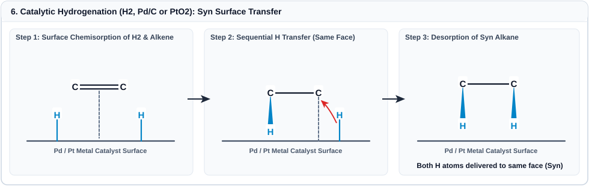

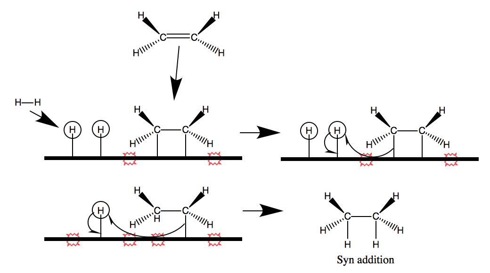

### 表面反應三步驟（McMurry 催化表面機構）
- **Step 1（吸附 Adsorption）**：$\text{H}_2$ 分子在金屬催化劑（$\text{Pd}$ 或 $\text{Pt}$）表面發生解離化學吸附（dissociative chemisorption），斷裂 $\text{H–H}$ 鍵形成金屬表面氫原子（$\text{M–H}$）；同時烯烴以 $\pi$ 鍵平面貼附（配位）在金屬催化劑表面。
- **Step 2（第一次氫轉移）**：表面上的一個 $\text{H}$ 原子從烯烴朝向金屬的那一面（bottom face）轉移至其中一個碳上，形成短暫的半氫化表面烷基-金屬鍵（$\text{M–C–C–H}$）。
- **Step 3（第二次氫轉移與脫附）**：第二個 $\text{H}$ 原子同樣從**貼著金屬表面的同一側（same face）**轉移至另一個碳上，飽和烷烴從金屬表面脫附（desorption），因此兩個 $\text{H}$ 原子必定從同一面加上（**syn addition**）。

---

## 7. Epoxidation (`epoxidation`)：過氧酸（mCPBA）蝴蝶型協同環氧化機構
- **對應反應卡**：[epoxidation.md](ch08/cards/epoxidation.md)
- **總反應式**：
  $$\text{R}_2\text{C=CR}_2 + \text{R'CO}_3\text{H (e.g. mCPBA)} \xrightarrow{\text{CH}_2\text{Cl}_2} \text{Epoxide (oxirane)} + \text{R'CO}_2\text{H}$$
- **反應特徵**：Concerted one-step syn addition（Butterfly TS）｜**Stereo: Syn, stereospecific**｜**Rearrangement: NO**

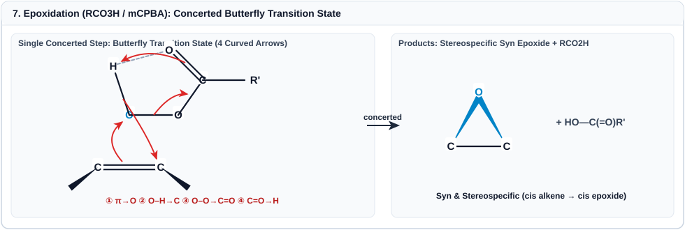

### 單步協同蝴蝶型過渡態（Concerted Butterfly Transition State）
1. **LaTeX 步驟式**：
   $$\text{C=C} + \text{R'C(=O)O–OH} \xrightarrow{\text{[Butterfly TS]}^\ddagger} \text{C–C(O) (epoxide)} + \text{R'C(=O)OH}$$
2. **彎箭頭電子流向（4 個同步彎箭頭，Concerted）**：
   - **箭頭 ①（`C=C π 鍵 ↷ 末端過氧 O`）**：烯烴 $\pi$ 鍵攻擊過氧酸（$\text{R'CO}_3\text{H}$）最外端具親電性的過氧氧原子（distal oxygen），形成第一個 $\text{C–O}$ 鍵。
   - **箭頭 ②（`末端 O–H σ 鍵 ↷ 另一個雙鍵 C`）**：同一瞬間，末端氧上的 $\text{O–H}$ $\sigma$ 鍵（或末端氧的孤對電子）回捐給另一個雙鍵碳，形成第二個 $\text{C–O}$ 鍵（建立三員環 **epoxide**）。
   - **箭頭 ③（`O–O 過氧鍵 ↷ C=O`）**：脆弱的 $\text{O–O}$ 過氧單鍵斷裂，電子對轉移形成新的羰基 $\text{C=O}$ $\pi$ 鍵。
   - **箭頭 ④（`原本的 C=O π 鍵 ↷ H`）**：原本羰基的 $\text{C=O}$ $\pi$ 鍵抓取剛剛釋出的質子 $\text{H}^+$，直接生成中性的羧酸副產物 $\text{R'CO}_2\text{H}$。
   - **立體化學結論**：因為兩個 $\text{C–O}$ 鍵在單一步驟中於同一面同步生成，烯烴原有的 *cis* / *trans* 幾何構型完全保留於環氧乙烷產物中（**syn, stereospecific**）。

---

## 8. Acid-Catalyzed Epoxide Hydrolysis (`epoxide-hydrolysis`)：酸催化環氧乙烷背面開環
- **對應反應卡**：[epoxide-hydrolysis.md](ch08/cards/epoxide-hydrolysis.md)
- **總反應式**：
  $$\text{Epoxide} + \text{H}_2\text{O} \xrightarrow{\text{H}_3\text{O}^+} \text{trans-1,2-diol}$$
- **反應特徵**：Protonated epoxide intermediate（三員環）｜**Stereo: Anti $\to$ trans-1,2-diol**｜**Rearrangement: NO**

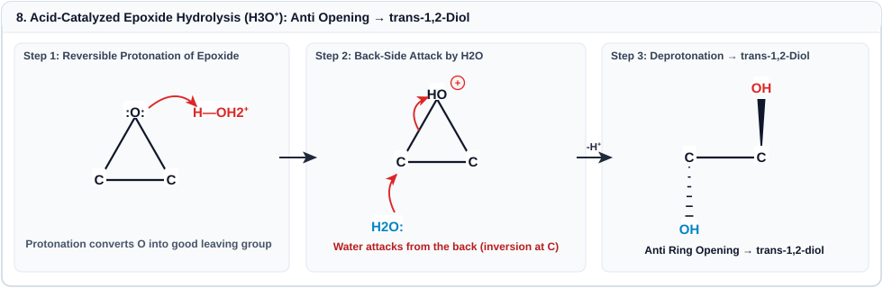

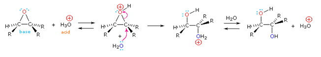

### Step 1：環氧乙烷氧原子快速可逆質子化，形成 Protonated Epoxide
1. **LaTeX 步驟式**：
   $$\text{Epoxide} + \text{H}_3\text{O}^+ \rightleftharpoons \text{Protonated Epoxide} + \text{H}_2\text{O}$$
2. **彎箭頭電子流向（Curved Arrows）**：
   - **箭頭 ①（`Epoxide O 孤對電子 ↷ H–OH2⁺`）** 與 **箭頭 ②（`H–O⁺ σ 鍵 ↷ O`）**：環氧乙烷的氧孤對電子抓取 $\text{H}_3\text{O}^+$ 的質子並釋出 $\text{H}_2\text{O}$，形成高度活化的三員環 **protonated epoxide**。

### Step 2：水分子由背面攻擊（Back-side Attack），打開三員環
1. **LaTeX 步驟式**：
   $$\text{Protonated Epoxide} + \text{H}_2\ddot{\text{O}}: \xrightarrow{\text{back-side attack}} \text{HO–C–C–}\overset{+}{\text{O}}\text{H}_2$$
2. **彎箭頭電子流向（Curved Arrows）**：
   - **箭頭 ①（`H2O 孤對電子 ↷ 三員環碳背面`）**：水分子由環氧環的背面（back-side）進行親核攻擊（若為不對稱環氧乙烷，如 `1-methyl-1,2-epoxycyclohexane`，因為 protonated epoxide 的多取代碳帶較大 $\delta+$，水會優先從多取代碳的背面進攻）。
   - **箭頭 ②（`C–O⁺ σ 鍵 ↷ O⁺`）**：被攻擊碳的 $\text{C–O}^+$ 鍵斷裂，讓該碳發生構型翻轉（inversion），兩個氧原子必定位於環平面的上下異側（**anti**）。

### Step 3：去質子化生成 *trans*-1,2-Diol 並再生 $\text{H}_3\text{O}^+$ 催化劑
1. **LaTeX 步驟式**：
   $$\text{HO–C–C–}\overset{+}{\text{O}}\text{H}_2 + \text{H}_2\ddot{\text{O}}: \longrightarrow \text{HO–C–C–OH (trans-1,2-diol)} + \text{H}_3\text{O}^+$$
2. **彎箭頭電子流向（Curved Arrows）**：
   - **箭頭 ①（`H2O 孤對電子 ↷ H–O⁺`）** 與 **箭頭 ②（`O–H σ 鍵 ↷ O⁺`）**：水分子移去質子，得到 **trans-1,2-diol**。

---

## 9. Dihydroxylation (`oso4-hydroxylation`)：$\text{OsO}_4$ 順式雙羥基化與還原／催化循環
- **對應反應卡**：[oso4-hydroxylation.md](ch08/cards/oso4-hydroxylation.md)
- **總反應式**：
  $$\text{R}_2\text{C=CR}_2 \xrightarrow[2.\text{ NaHSO}_3,\text{ H}_2\text{O}\;\text{ (or cat. OsO}_4\text{ + NMO)}]{1.\text{ OsO}_4} \text{cis-1,2-diol}$$
- **反應特徵**：Cyclic osmate(VI) ester intermediate｜**Stereo: Syn $\to$ cis-1,2-diol**｜**Rearrangement: NO**

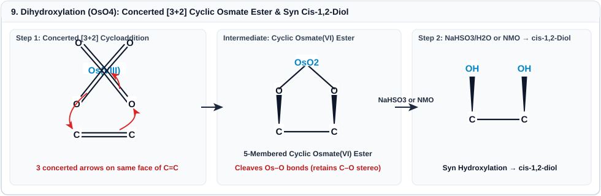

### Step 1：$\text{OsO}_4$ 與烯烴發生協同 $[3+2]$ 環加成，形成五員環 Cyclic Osmate Ester
1. **LaTeX 步驟式**：
   $$\text{C=C} + \text{OsO}_4 \;\text{[Os(VIII)]} \xrightarrow{\text{concerted syn [3+2]}} \text{Cyclic Osmate(VI) Ester}$$
2. **彎箭頭電子流向（3 個同步彎箭頭，Concerted）**：
   - **箭頭 ①（`C=C π 鍵 ↷ 第一個 =O`）**：烯烴富電子的 $\pi$ 鍵攻擊 $\text{OsO}_4$ 上的一個端基氧原子，建立第一個 $\text{C–O}$ $\sigma$ 鍵。
   - **箭頭 ②（`第一個 Os=O π 鍵 ↷ Os`）**：該 $\text{Os=O}$ 的 $\pi$ 電子對流入鋨金屬中心，使鋨由 $\text{Os(VIII)}$ 被還原為 $\text{Os(VI)}$。
   - **箭頭 ③（`第二個 Os=O π 鍵 ↷ 另一個雙鍵 C`）**：鄰近另一個 $\text{Os=O}$ 的 $\pi$ 電子對同步從**同一側（same face）**攻擊另一個雙鍵碳，建立第二個 $\text{C–O}$ $\sigma$ 鍵，形成五員環 **cyclic osmate ester**。

### Step 2：切斷 $\text{Os–O}$ 鍵（保留 $\text{C–O}$ 鍵）釋出 *cis*-1,2-Diol `[needs-review]`
- **關鍵立體化學原理**：無論用哪種後續處理，斷裂的都是 **$\text{Os–O}$ 鍵**而非 $\text{C–O}$ 鍵，因此碳上的兩個 $-\text{OH}$ 完全維持 Step 1 的同側構型（**retention at both C $\to$ cis-1,2-diol**）。
1. **路徑 2A（化學計量法：$\text{NaHSO}_3 / \text{H}_2\text{O}$ 還原水解）**：
   $$\text{Cyclic Osmate(VI) Ester} + \text{HSO}_3^- + 2\,\text{H}_2\text{O} \longrightarrow \text{cis-1,2-diol} + \text{Os(IV)/Os(VI) 水合鹽} + \text{SO}_4^{2-}$$
2. **路徑 2B（Upjohn 催化法：催化量 $\text{OsO}_4$ + 共氧化劑 NMO）**：
   $$\text{Cyclic Osmate(VI) Ester} + \text{R}_3\text{N}^+\text{–O}^-\text{ (NMO)} + 2\,\text{H}_2\text{O} \longrightarrow \text{cis-1,2-diol} + \text{OsO}_4\text{ (再生)} + \text{R}_3\text{N: (N-methylmorpholine)}$$

---

## 10. Dichlorocarbene Addition (`carbene-dichloro`)：$\alpha$-消去生成 $:!\text{CCl}_2$ 與協同環丙烷化
- **對應反應卡**：[carbene-dichloro.md](ch08/cards/carbene-dichloro.md)
- **總反應式**：
  $$\text{R}_2\text{C=CR}_2 + \text{CHCl}_3 + \text{KOH} \longrightarrow \text{1,1-Dichlorocyclopropane} + \text{KCl} + \text{H}_2\text{O}$$
- **反應特徵**：$\alpha$-Elimination 生成單重態卡賓 $:!\text{CCl}_2$｜**Stereo: Syn, stereospecific**｜**Rearrangement: NO**

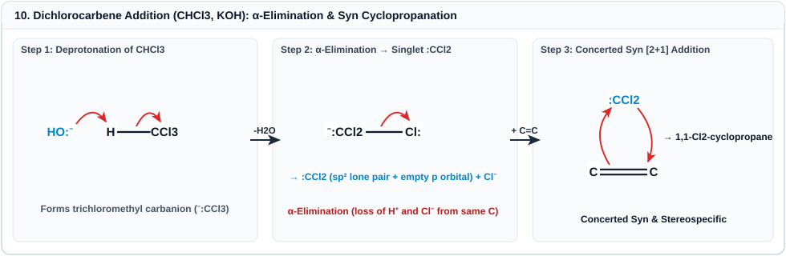

### Step 1：強鹼 $\text{OH}^-$ 對氯仿（$\text{CHCl}_3$）去質子化，形成三氯甲基碳負離子（Trichloromethyl Anion）
1. **LaTeX 步驟式**：
   $$\text{HO:}^- + \text{H–CCl}_3 \rightleftharpoons \text{H}_2\text{O} + :\!\overset{-}{\text{C}}\text{Cl}_3$$
2. **彎箭頭電子流向（Curved Arrows）**：
   - **箭頭 ①（`OH⁻ 孤對電子 ↷ H–CCl3`）**：$\text{OH}^-$ 抓取 $\text{CHCl}_3$ 上的酸性氫。
   - **箭頭 ②（`H–C σ 鍵 ↷ C`）**：$\text{C–H}$ $\sigma$ 電子對留在碳原子上，形成受三個氯原子誘導拉電子效應穩定的碳負離子 $:\!\overset{-}{\text{C}}\text{Cl}_3$。

### Step 2：$\alpha$-消去（Loss of $\text{Cl}^-$）生成電中性單重態二氯卡賓（Dichlorocarbene, $:!\text{CCl}_2$）
1. **LaTeX 步驟式**：
   $$:\!\overset{-}{\text{C}}\text{Cl}_3 \longrightarrow :\!\text{CCl}_2\;\text{(dichlorocarbene)} + :\!\ddot{\text{Cl}}\!:^-$$
2. **彎箭頭電子流向（Curved Arrows）**：
   - **箭頭 ①（`C–Cl σ 鍵 ↷ Cl`）**：同一個碳（$\alpha$-C）上的一個 $\text{C–Cl}$ 鍵斷裂，釋出 $\text{Cl}^-$，形成電中性的 **dichlorocarbene ($:!\text{CCl}_2$)**。
   - **電子結構重點**：$:!\text{CCl}_2$ 的碳為 $sp^2$ 混成，外層只有 6 個價電子（同時具有一個**空 $p$ 軌域**與一對 **$sp^2$ 孤對電子**），兼具親電性與親核性。

### Step 3：$:!\text{CCl}_2$ 與烯烴發生單步協同 $[2+1]$ 環加成（Concerted Syn Cycloaddition）
1. **LaTeX 步驟式**：
   $$\text{R}_2\text{C=CR}_2 + :\!\text{CCl}_2 \xrightarrow{\text{concerted syn}} \text{1,1-Dichlorocyclopropane}$$
2. **彎箭頭電子流向（2 個同步彎箭頭，Concerted）**：
   - **箭頭 ①（`C=C π 鍵 ↷ :CCl2 空 p 軌域`）**：烯烴 $\pi$ 鍵電子對流入 $:!\text{CCl}_2$ 的空 $p$ 軌域。
   - **箭頭 ②（`:CCl2 孤對電子 ↷ 另一個雙鍵 C`）**：同一瞬間，$:!\text{CCl}_2$ 的 $sp^2$ 孤對電子回捐給另一個雙鍵碳，從**同一側（syn）**同時建立兩個新的 $\text{C–C}$ 鍵（**stereospecific**）。

---

## 11. Simmons–Smith Reaction (`simmons-smith`)：類卡賓（Carbenoid）協同環丙烷化
- **對應反應卡**：[simmons-smith.md](ch08/cards/simmons-smith.md)
- **總反應式**：
  $$\text{R}_2\text{C=CR}_2 + \text{CH}_2\text{I}_2 + \text{Zn(Cu)} \xrightarrow{\text{ether}} \text{Cyclopropane} + \text{ZnI}_2$$
- **反應特徵**：Carbenoid ($\text{ICH}_2\text{ZnI}$) 蝴蝶型協同過渡態｜**Stereo: Syn, stereospecific**｜**Rearrangement: NO**

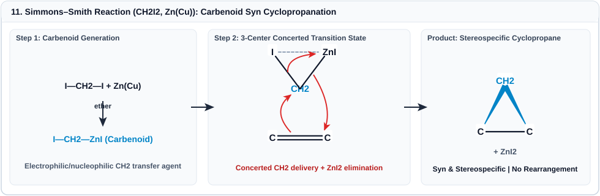

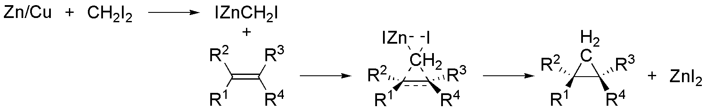

### Step 1：鋅銅偶（$\text{Zn(Cu)}$）氧化插入 $\text{CH}_2\text{I}_2$，形成類卡賓試劑（Simmons–Smith Carbenoid）
1. **LaTeX 步驟式**：
   $$\text{I–CH}_2\text{–I} + \text{Zn(Cu)} \xrightarrow{\text{ether}} \text{I–CH}_2\text{–ZnI} \quad (\text{iodomethylzinc iodide, carbenoid})$$

### Step 2：Carbenoid 與烯烴經由三中心蝴蝶型過渡態協同轉移 $\text{CH}_2$（Concerted Syn Addition） `[needs-review]`
1. **LaTeX 步驟式**：
   $$\text{R}_2\text{C=CR}_2 + \text{I–CH}_2\text{–ZnI} \xrightarrow{\text{[3-center concerted TS]}^\ddagger} \text{Cyclopropane} + \text{ZnI}_2$$
2. **彎箭頭電子流向（3 個同步彎箭頭，Concerted）**： `[needs-review]`
   - **箭頭 ①（`C=C π 鍵 ↷ CH2 碳`）**：烯烴 $\pi$ 鍵攻擊 $\text{I–CH}_2\text{–ZnI}$ 的亞甲基碳（$\text{CH}_2$），建立第一個 $\text{C–C}$ 鍵。
   - **箭頭 ②（`C–I σ 鍵 ↷ I (轉移至 Zn)`）**：亞甲基碳上的 $\text{C–I}$ 鍵同步斷裂，$\text{I}^-$ 轉移配位至親鹵性的鋅原子上。
   - **箭頭 ③（`C–Zn σ 鍵 ↷ 另一個雙鍵 C`）**：同一瞬間，$\text{CH}_2\text{–ZnI}$ 的 $\text{C–Zn}$ $\sigma$ 鍵電子對從同一面回捐給另一個雙鍵碳，建立第二個 $\text{C–C}$ 鍵並脫去穩定的 $\text{ZnI}_2$。

---

## 12. Ozonolysis (`ozonolysis`)：臭氧化（Molozonide $\to$ Criegee 重排 $\to$ Ozonide $\to$ 還原裂解）
- **對應反應卡**：[ozonolysis.md](ch08/cards/ozonolysis.md)
- **總反應式**：
  $$\text{R}_2\text{C=CHR'} \xrightarrow[2.\text{ Zn, H}_3\text{O}^+\text{ (or Me}_2\text{S)}]{1.\text{ O}_3} \text{R}_2\text{C=O} + \text{O=CHR'}$$
- **反應特徵**：Oxidative cleavage｜中間體：Molozonide $\to$ **Ozonide**｜**停在 Aldehyde / Ketone（不過度氧化）**

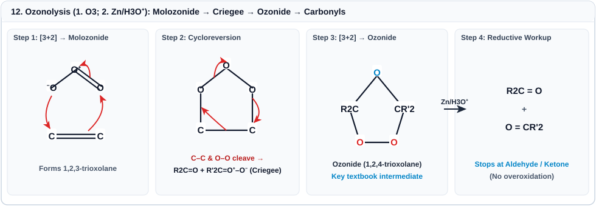

### Step 1：臭氧（$\text{O}_3$）與烯烴進行 1,3-偶極環加成（$[3+2]$ Cycloaddition），生成初級臭氧化物 Molozonide
1. **LaTeX 步驟式**：
   $$\text{R}_2\text{C=CR'}_2 + \ddot{\text{O}}=\overset{+}{\text{O}}\text{–}\ddot{\text{O}}\!:^- \xrightarrow{\text{concerted [3+2]}} \text{Molozonide (1,2,3-trioxolane)}$$
2. **彎箭頭電子流向（3 個同步彎箭頭）**：
   - **箭頭 ①（`C=C π 鍵 ↷ 端基親電 O`）**、**箭頭 ②（`O=O⁺ π 鍵 ↷ 中心 O⁺`）**、**箭頭 ③（`端基 O⁻ 孤對電子 ↷ 另一個雙鍵 C`）**：形成五員環 **molozonide**（1,2,3-trioxolane）。

### Step 2：Molozonide 發生逆 1,3-偶極裂解（Retro-$[3+2]$ Cycloreversion），斷開 $\text{C–C}$ 單鍵 `[needs-review]`
1. **LaTeX 步驟式**：
   $$\text{Molozonide} \longrightarrow \text{R}_2\text{C=O (Carbonyl)} + \text{R'}_2\text{C}=\overset{+}{\text{O}}\text{–}\ddot{\text{O}}\!:^-\text{ (Criegee Carbonyl Oxide Zwitterion)}$$
2. **彎箭頭電子流向（3 個同步彎箭頭）**： `[needs-review]`
   - **箭頭 ①（`C–C σ 鍵 ↷ 左側 C–O`）**：原本烯烴的 $\text{C–C}$ 鍵在此步徹底斷裂，電子對轉為左側的 $\text{C=O}$ 雙鍵。
   - **箭頭 ②（`左側 C–O–O 的 O–O 鍵 ↷ 中間 O`）**：脆弱的 $\text{O–O}$ 過氧鍵斷裂，電子對歸給左側羰基氧。
   - **箭頭 ③（`右側 O 孤對電子 ↷ 右側 C`）**：右側氧原子的孤對電子下推形成 $\text{C=O}^+\text{–O}^-$（**Criegee zwitterion / carbonyl oxide**）。

### Step 3：羰基碎片翻轉並與 Criegee 偶極體重新進行 $[3+2]$ 環加成，形成穩定的 Ozonide `[needs-review]`
1. **LaTeX 步驟式**：
   $$\text{R}_2\text{C=O} + \text{R'}_2\text{C}=\overset{+}{\text{O}}\text{–}\ddot{\text{O}}\!:^- \xrightarrow{\text{[3+2] recombination}} \text{Ozonide (1,2,4-trioxolane)}$$
2. **彎箭頭電子流向（3 個同步彎箭頭）**： `[needs-review]`
   - **箭頭 ①（`Criegee O⁻ 孤對電子 ↷ 左側羰基 C`）**、**箭頭 ②（`左側 C=O π 鍵 ↷ 右側 Criegee C`）**、**箭頭 ③（`Criegee C=O⁺ π 鍵 ↷ O⁺`）**：重新組合成課本所畫出的關鍵中間體 **ozonide**（1,2,4-trioxolane）。

### Step 4：還原處理（Reductive Workup：$\text{Zn} / \text{H}_3\text{O}^+$ 或 $\text{Me}_2\text{S}$）分解 Ozonide 生成兩分子 Carbonyls `[needs-review]`
1. **LaTeX 步驟式**：
   $$\text{Ozonide} + \text{Zn} + \text{H}_3\text{O}^+ \longrightarrow \text{R}_2\text{C=O} + \text{R'}_2\text{C=O} + \text{Zn}^{2+} + \text{H}_2\text{O}$$
2. **彎箭頭電子流向**： `[needs-review]`
   - 還原劑 $\text{Zn}$ 將 ozonide 的過氧橋還原切斷，一側形成第一個 $\text{C=O}$，另一側同時斷開醚氧橋形成第二個 $\text{C=O}$。因為過氧氧原子被還原劑奪走，**生成的 aldehyde ($\text{RCH=O}$) 不會被進一步氧化成羧酸**！

---

## 13. $\text{KMnO}_4$ Oxidative Cleavage (`kmno4-cleavage`)：酸性高錳酸鉀氧化裂解與過度氧化
- **對應反應卡**：[kmno4-cleavage.md](ch08/cards/kmno4-cleavage.md)
- **總反應式**：
  $$\text{R}_2\text{C=CHR'} \xrightarrow{\text{KMnO}_4,\text{ H}_3\text{O}^+} \text{R}_2\text{C=O} + \text{R'COOH} \quad (\text{若含 }=\!\text{CH}_2\text{ 則氧化為 }\text{CO}_2\uparrow)$$
- **反應特徵**：Strong oxidative cleavage｜**Overoxidizes: $\text{=CHR} \to \text{RCOOH}$，$\text{=CH}_2 \to \text{CO}_2$**

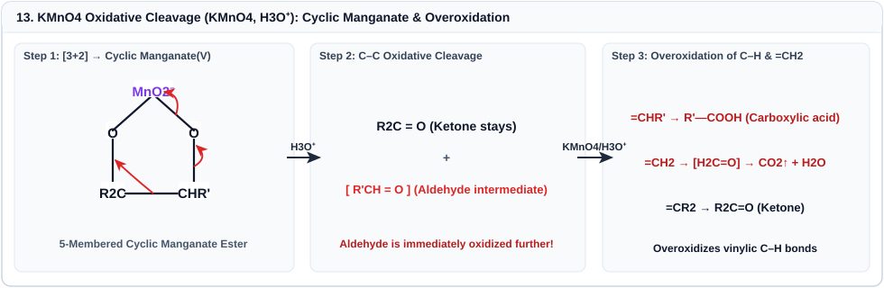

### Step 1：$\text{MnO}_4^-$ 與烯烴進行 $[3+2]$ 環加成，形成環狀錳酸酯 Cyclic Manganate(V) Intermediate `[needs-review]`
1. **LaTeX 步驟式**：
   $$\text{R}_2\text{C=CHR'} + \text{MnO}_4^-\;\text{[Mn(VII)]} \xrightarrow{\text{syn [3+2]}} \text{Cyclic Manganate(V) Diester}$$

### Step 2：酸性／加熱條件下環狀錳酸酯氧化裂解 $\text{C–C}$ 鍵，生成初始羰基化合物 `[needs-review]`
1. **LaTeX 步驟式**：
   $$\text{Cyclic Manganate(V) Diester} \xrightarrow{\text{H}_3\text{O}^+} \text{R}_2\text{C=O} + [\text{O=CHR'}] + \text{MnO}_2\downarrow\text{ / Mn}^{2+}$$

### Step 3：過度氧化（Overoxidation）：醛基 $\text{R'CH=O} \to \text{R'COOH}$ 與末端 $=\text{CH}_2 \to \text{CO}_2$ `[needs-review]`
1. **LaTeX 步驟式**：
   $$\text{R'CH=O} + \text{H}_2\text{O} \stackrel{\text{H}_3\text{O}^+}{\rightleftharpoons} \text{R'CH(OH)}_2 \xrightarrow{\text{HMnO}_4} \text{R'CH(OH)–O–MnO}_3\text{H} \longrightarrow \text{R'COOH} + \text{H}_2\text{MnO}_3$$
   $$\text{若為末端 }=\!\text{CH}_2\text{：}\quad \text{H}_2\text{C=O (formaldehyde)} \xrightarrow{\text{KMnO}_4} \text{HCOOH (formic acid)} \xrightarrow{\text{KMnO}_4} \text{O=C=O}\uparrow + \text{H}_2\text{O}$$

---

## 14. Periodate Cleavage of 1,2-Diols (`diol-cleavage`)：$\text{HIO}_4$ 環狀高碘酸酯裂解機構
- **對應反應卡**：[diol-cleavage.md](ch08/cards/diol-cleavage.md)
- **總反應式**：
  $$\text{R}_2\text{C(OH)–C(OH)R'}_2 + \text{HIO}_4 \xrightarrow{\text{H}_2\text{O}} \text{R}_2\text{C=O} + \text{R'}_2\text{C=O} + \text{HIO}_3 + \text{H}_2\text{O}$$
- **反應特徵**：5-Membered cyclic periodate ester intermediate｜**將 1,2-diol 裂解為 2 個 Carbonyls**

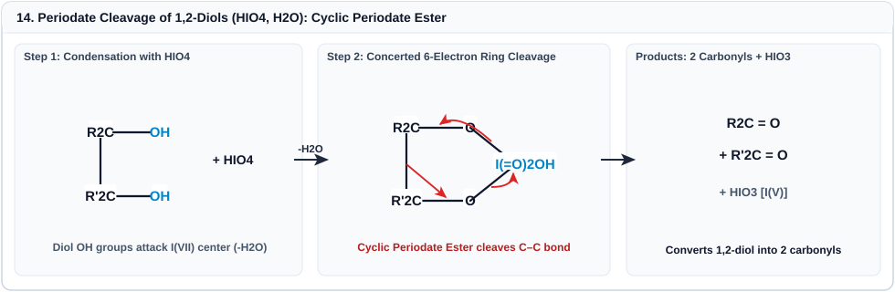

### Step 1：1,2-Diol 的兩個 $-\text{OH}$ 親核攻擊 $\text{HIO}_4$，脫水形成五員環 Cyclic Periodate Ester
1. **LaTeX 步驟式**：
   $$\text{1,2-Diol} + \text{HIO}_4\;\text{[I(VII)]} \rightleftharpoons \text{Cyclic Periodate Ester} + \text{H}_2\text{O}$$

### Step 2：五員環高碘酸酯發生協同 6 電子環裂解，切斷 $\text{C–C}$ 鍵並釋出兩分子 Carbonyls
1. **LaTeX 步驟式**：
   $$\text{Cyclic Periodate Ester} \xrightarrow{\text{concerted cleavage}} \text{R}_2\text{C=O} + \text{R'}_2\text{C=O} + \text{HIO}_3\;\text{[I(V)]}$$
2. **彎箭頭電子流向（3 個同步彎箭頭，Concerted）**：
   - **箭頭 ①（`C–C σ 鍵 ↷ 下方 C–O`）**：1,2-diol 原本的 $\text{C–C}$ 單鍵斷裂，電子對轉移形成下方碳的 $\text{C=O}$ 雙鍵。
   - **箭頭 ②（`下方 O–I σ 鍵 ↷ I(VII)`）**：下方 $\text{O–I}$ 鍵斷裂，電子對流入高氧化態的碘原子，使 $\text{I(VII)}$ 還原為穩定的 $\text{I(V)}$（碘酸 $\text{HIO}_3$）。
   - **箭頭 ③（`上方 O–I σ 鍵 ↷ 上方 C–O`）**：上方 $\text{O–I}$ 鍵同步斷裂，電子對轉移形成上方碳的 $\text{C=O}$ 雙鍵，一次產生兩個羰基化合物！

---

# Chapter 10：Organohalides

## 15. Allylic Bromination with NBS (`allylic-bromination`)：NBS 自由基鏈鎖反應與 $\text{Br}_2$ 低濃度循環
- **對應迷思筆記**：[misconceptions.md](misconceptions.md) `[needs-review]`
- **總反應式**：
  $$\text{R–CH}_2\text{–CH=CH}_2 + \text{NBS (N-bromosuccinimide)} \xrightarrow{h\nu\text{ or ROOR, CCl}_4} \text{R–CH(Br)–CH=CH}_2 + \text{Succinimide}$$
- **反應特徵**：Radical chain substitution｜中間體：**Resonance-stabilized allylic radical**｜只取代 allylic H

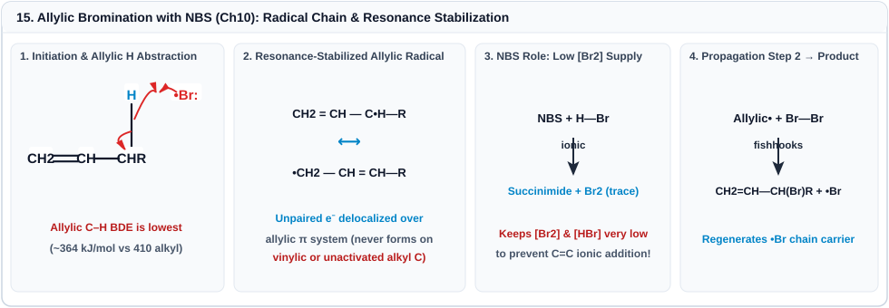

### Step 1：鏈起始（Chain Initiation）— 光照或過氧化物均裂產生溴自由基 $\text{Br}\cdot$
1. **LaTeX 步驟式**：
   $$\text{Br–Br (or NBS N–Br)} \xrightarrow{h\nu} 2\,\cdot\ddot{\text{Br}}:$$
2. **單鉤箭頭電子流向（Fishhook Arrows）**：
   - **單鉤箭頭 ① & ②（`Br–Br 鍵 ⇀ Br•` 與 `↽ Br•`）**：微量 $\text{Br}_2$（或 NBS 的 $\text{N–Br}$ 弱鍵）受光照射發生均裂（homolysis），一對共價電子一分為二，產生高活性的溴自由基 $\text{Br}\cdot$。

### Step 2：鏈增長第一步（Propagation Step 1）— $\text{Br}\cdot$ 選擇性抓取 Allylic H，形成共振穩定的 Allylic Radical
1. **LaTeX 步驟式**：
   $$\text{R–CH=CH–CH}_2\text{–H} + \cdot\text{Br} \longrightarrow [\text{R–CH=CH–}\dot{\text{C}}\text{H}_2 \longleftrightarrow \text{R–}\dot{\text{C}}\text{H–CH=CH}_2] + \text{H–Br}$$
2. **單鉤箭頭電子流向與選擇性原因**：
   - **單鉤箭頭 ①（`Allylic C–H 鍵 ⇀ H`）** 與 **單鉤箭頭 ②（`Br• 單電子 ⇀ H`）**：配對形成 $\text{H–Br}$。
   - **單鉤箭頭 ③（`Allylic C–H 鍵另一電子 ⇀ Allylic C`）**：單電子留在 allylic 碳上。
   - **為什麼只抓 Allylic H？** 因為生成的 allylic radical 未成對電子位於 $p$ 軌域，可與旁邊的 $\text{C=C}$ $\pi$ 鍵形成三碳共軛共振系統（resonance stabilization），使其 **allylic C–H 的鍵解離能（BDE $\approx 364\text{ kJ/mol}$）全分子最低**（遠低於一般 alkyl C–H $\approx 410\text{ kJ/mol}$ 與 vinylic C–H $\approx 465\text{ kJ/mol}$）。

### Step 3：NBS 的關鍵角色 — 與生成的 $\text{HBr}$ 進行離子反應，穩定供應極低濃度的 $\text{Br}_2$
1. **LaTeX 步驟式**：
   $$\text{NBS (N-bromosuccinimide)} + \text{H–Br} \longrightarrow \text{Succinimide (N–H)} + \text{Br–Br (low concentration)}$$
2. **作用原理解析**：
   - 使用不溶於 $\text{CCl}_4$ 的固體 **NBS** 時，Step 2 每產生一分子 $\text{HBr}$，NBS 就與其反應釋出一分子 $\text{Br}_2$，讓溶液中 $\text{Br}_2$ 與 $\text{HBr}$ 濃度始終維持在極低水平，徹底抑制雙鍵上的離子加成（`x2-addition`）！

### Step 4：鏈增長第二步（Propagation Step 2）— Allylic Radical 與 $\text{Br}_2$ 反應生成產物並再生 $\text{Br}\cdot$
1. **LaTeX 步驟式**：
   $$\text{R–CH=CH–}\dot{\text{C}}\text{H}_2 + \text{Br–Br} \longrightarrow \text{R–CH=CH–CH}_2\text{Br}\;\text{(+ allylic isomer)} + \cdot\text{Br}$$

---

## 16. Preparation of Alkyl Halides from Alcohols (`alcohol-to-alkyl-halide`)：$\text{HX}$、$\text{SOCl}_2$、$\text{PBr}_3$ 與 $\text{DAST}/\text{HF}$ 完整機構
- **對應反應卡**：[alcohol-to-alkyl-halide.md](ch10/cards/alcohol-to-alkyl-halide.md) `[needs-review]`
- **共同核心邏輯**：醇的 $-\text{OH}$ 是強鹼、極差的離去基（$\text{p}K_\text{a}(\text{H}_2\text{O}) = 15.7$）；所有試劑的第一步都是**先將 $-\text{OH}$ 轉化為好離去基**，再進行親核取代。

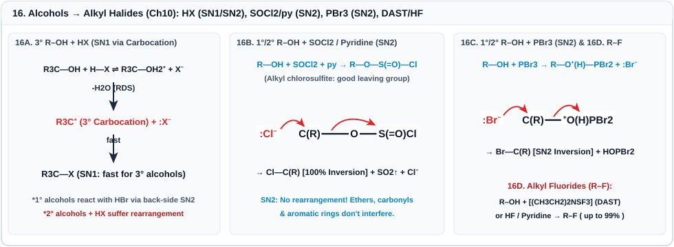

---

### 16A. Alcohol + $\text{HX}$ ($\text{HCl}, \text{HBr}, \text{HI}$)：依級數走 $\text{S}_\text{N}1$（$3^\circ/2^\circ$）或 $\text{S}_\text{N}2$（$1^\circ$）
1. **$3^\circ$（及 $2^\circ$）醇 + $\text{HX}$：$\text{S}_\text{N}1$ 機構（三步驟：質子化 $\to$ 脫水生成 Carbocation $\to$ $\text{X}^-$ 捕獲）**
   $$\text{R}_3\text{C–}\ddot{\text{O}}\text{H} + \text{H–X} \stackrel{\text{Step 1 (fast)}}{\rightleftharpoons} \text{R}_3\text{C–}\overset{+}{\text{O}}\text{H}_2 + \text{X}^- \xrightarrow[-\text{H}_2\text{O}]{\text{Step 2 (slow, RDS)}} \text{R}_3\text{C}^+ + \text{X}^- \xrightarrow{\text{Step 3 (fast)}} \text{R}_3\text{C–X}$$
2. **$1^\circ$ 醇（及甲醇）+ $\text{HBr}$ / $\text{HI}$：$\text{S}_\text{N}2$ 機構（兩步驟：質子化 $\to$ $\text{X}^-$ 背面協同攻擊）**
   $$\text{RCH}_2\text{–}\ddot{\text{O}}\text{H} + \text{H–Br} \rightleftharpoons \text{RCH}_2\text{–}\overset{+}{\text{O}}\text{H}_2 + :\!\ddot{\text{Br}}\!:^- \xrightarrow{\text{back-side S}_\text{N}2} \text{RCH}_2\text{–Br} + \text{H}_2\text{O}$$

---

### 16B. $1^\circ / 2^\circ$ Alcohol + $\text{SOCl}_2$ in Pyridine：Chlorosulfite 中間體與 $\text{S}_\text{N}2$ 構型翻轉機構
- **總反應式**：
  $$\text{R–OH} + \text{SOCl}_2 + \text{C}_5\text{H}_5\text{N (pyridine)} \longrightarrow \text{R–Cl (inversion)} + \text{SO}_2\uparrow + \text{C}_5\text{H}_5\text{NH}^+\text{Cl}^-$$
1. **Step 1：醇的 $-\text{OH}$ 親核進攻 $\text{SOCl}_2$ 的硫中心，經加成—消去形成 Alkyl Chlorosulfite**
   $$\text{R–}\ddot{\text{O}}\text{H} + \text{Cl–S(=O)–Cl} \longrightarrow \text{R–}\overset{+}{\text{O}}\text{(H)–S(O}^-\text{)Cl}_2 \xrightarrow{-\text{Cl}^-,\;-\text{H}^+\text{ (by pyridine)}} \text{R–O–S(=O)–Cl} + \text{PyH}^+ + \text{Cl}^-$$
2. **Step 2：$:\!\ddot{\text{Cl}}\!:^-$ 由碳背面進行 $\text{S}_\text{N}2$ 攻擊，同步崩解脫去 $\text{SO}_2\uparrow$ 與 $\text{Cl}^-$**
   $$:\!\ddot{\text{Cl}}\!:^- + \text{R–O–S(=O)–Cl} \xrightarrow{\text{back-side S}_\text{N}2} \text{Cl–R (inverted)} + \text{O=S=O}\uparrow + :\!\ddot{\text{Cl}}\!:^-$$
   - **彎箭頭 ①（`Cl⁻ 孤對電子 ↷ C 背面`）**：$\text{Cl}^-$ 由背面進行 $\text{S}_\text{N}2$ 進攻，使對掌碳發生 **100% 構型翻轉（inversion of configuration）**。
   - **彎箭頭 ②（`C–O σ 鍵 ↷ O–S`）** 與 **箭頭 ③（`S–Cl σ 鍵 ↷ Cl`）**：$\text{C–O}$ 鍵斷裂轉成第二個 $\text{S=O}$ 雙鍵（生成穩定的 $\text{SO}_2$ 氣體逸出），同時釋出 $\text{Cl}^-$。

---

### 16C. $1^\circ / 2^\circ$ Alcohol + $\text{PBr}_3$ in Ether：Dibromophosphite 中間體與 $\text{S}_\text{N}2$ 構型翻轉機構
- **總反應式**：
  $$3\,\text{R–OH} + \text{PBr}_3 \xrightarrow{\text{ether}} 3\,\text{R–Br (inversion)} + \text{H}_3\text{PO}_3$$

1. **Step 1：醇的 $-\text{OH}$ 親核攻擊 $\text{PBr}_3$，取代一個 $\text{Br}^-$ 形成質子化二溴亞磷酸酯**
   $$\text{R–}\ddot{\text{O}}\text{H} + \text{PBr}_3 \longrightarrow \text{R–}\overset{+}{\text{O}}\text{(H)–PBr}_2 + :\!\ddot{\text{Br}}\!:^-$$
   - **彎箭頭 ①（`ROH 氧孤對電子 ↷ P`）** 與 **箭頭 ②（`P–Br σ 鍵 ↷ Br`）**：醇氧進攻親電性的磷原子並踢出 $:\!\ddot{\text{Br}}\!:^-$，將 $-\text{OH}$ 變成極佳的離去基 $-\overset{+}{\text{O}}(\text{H})\text{PBr}_2$。
2. **Step 2：$:\!\ddot{\text{Br}}\!:^-$ 由碳背面進行 $\text{S}_\text{N}2$ 攻擊，脫去 $\text{HOPBr}_2$**
   $$:\!\ddot{\text{Br}}\!:^- + \text{R–}\overset{+}{\text{O}}\text{(H)–PBr}_2 \xrightarrow{\text{back-side S}_\text{N}2} \text{Br–R (inverted)} + \text{HO–PBr}_2$$
   - **彎箭頭 ①（`Br⁻ 孤對電子 ↷ C 背面`）** 與 **箭頭 ②（`C–O⁺ σ 鍵 ↷ O⁺`）**：$\text{Br}^-$ 從碳背面進行 $\text{S}_\text{N}2$ 進攻（碳中心構型 **inversion**，且不經 carbocation 故**絕無重排**），脫去 $\text{HO–PBr}_2$（可再與 2 分子 $\text{R–OH}$ 反應，最終 $1\text{ mol }\text{PBr}_3$ 將 $3\text{ mol }\text{R–OH}$ 轉為 $3\text{ mol }\text{R–Br} + \text{H}_3\text{PO}_3$）。

---

### 16D. Alcohol + $\text{DAST}\;\text{[(CH}_3\text{CH}_2)_2\text{NSF}_3\text{]}$ 或 $\text{HF / Pyridine}$：製備 Alkyl Fluorides ($\text{R–F}$) `[needs-review]`
- **總反應式**：
  $$\text{R–OH} \xrightarrow{\text{[(CH}_3\text{CH}_2)_2\text{NSF}_3\text{] (DAST) or HF / Pyridine}} \text{R–F}$$
1. **DAST ($\text{Et}_2\text{NSF}_3$) 機構（類比 $\text{SOCl}_2$：先活化 $-\text{OH}$ 為 $-\text{O–SF}_2\text{NEt}_2$，再由 $\text{F}^-$ 取代）**
   $$\text{R–}\ddot{\text{O}}\text{H} + \text{F–SF}_2\text{–NEt}_2 \xrightarrow{-\text{HF}} \text{R–O–SF}_2\text{–NEt}_2 \xrightarrow{\text{F}^-} \text{F–R} + \text{O=S(F)–NEt}_2 + \text{F}^-$$
2. **$\text{HF / Pyridine}$（Olah's Reagent，針對 $2^\circ / 3^\circ$ 醇如 Cyclohexanol）**
   $$\text{R–OH} + \text{HF (in pyridine)} \rightleftharpoons \text{R–}\overset{+}{\text{O}}\text{H}_2 + \text{F}^- \longrightarrow \text{R–F (Fluorocyclohexane, 99\%)} + \text{H}_2\text{O}$$
